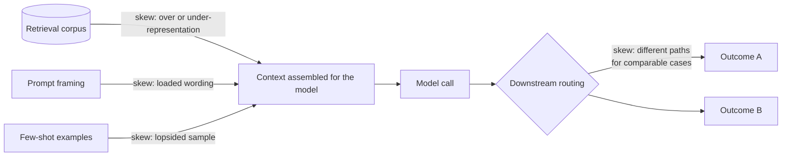
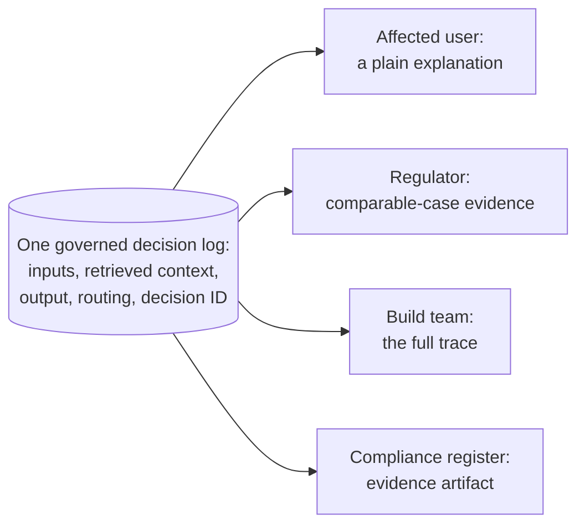
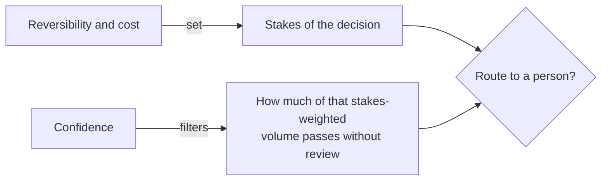

[Safeguarding Agentic Systems](/ai/agentic-system/safeguarding) covers the controls that stop a system from doing something it shouldn't — disallowed content, unauthorized actions, a compromised skill. This page covers a different failure class: a system that follows every rule, triggers no guardrail, and still produces an outcome nobody can explain, nobody reviewed, and nobody can prove was compliant. That gap is harder to detect, because on the surface the output looks completely normal.

All four sections below — fairness, transparency, human review, and compliance — turn out to draw on the *same* underlying record. Instead of asking "is the system healthy," this record answers "why did this specific decision happen," and once it exists, it serves every audience that needs an answer to that question.

## Fairness Enters at Specific, Inspectable Points

It's tempting to treat fairness as a property of the model — something the provider trained and evaluated upstream, before the system ever touched it. That framing breaks down the moment a model is paired with an application's own retrieval corpus, prompts, examples, and routing logic, because a model can pass every fairness evaluation its provider ran and still produce unequal outcomes once it's wired into a system of your own design.

Unequal outcomes enter at four controllable points:

1. **The retrieval corpus** over- or under-represents groups, so the context the model sees is already lopsided before it reasons about anything.
2. **Prompt framing** encodes an assumption — "flag anything suspicious about this applicant" leans toward finding fault in a way "summarize this applicant against these criteria" does not.
3. **Few-shot examples** reproduce whatever skew is in the handful of cases chosen to demonstrate the task.
4. **Downstream routing** sends comparable people down different paths after the output — the same score triggering automatic approval for one group and manual review for another.

Laid out across a pipeline, three of the four points sit before the model ever runs, and the fourth sits after:

Notice the model call itself isn't where any of the four points live — skew enters what the model is given, or what happens to what it produced, never the model's own evaluated behavior.

:::tip[What "skew" actually means here]
Skew is a countable lean, not a moral judgment — a corpus with 200 documents about one group and 12 about another, a prompt framed one way instead of a neutral way, a routing rule that splits otherwise-similar cases. It's descriptive, not an accusation, and it's usually accidental: a corpus assembled from whatever was easiest to collect, a prompt written quickly, a routing rule added for an unrelated reason. That's exactly why it's worth catching by inspection — each of the four points above is something you can open up and check, which is what makes fairness an architectural property instead of something you just have to trust the model on.
:::

Aggregate accuracy can look completely healthy while harm concentrates in one subgroup, because an aggregate number is, by construction, exactly the kind of signal that averages a concentrated problem away. The fix isn't a better aggregate metric — it's instrumenting the four entry points directly and checking each one.

## Transparency: One Decision Log, Three Audiences

To replay and explain any single decision, a system needs to retain a governed record of:

- the inputs and derived features that mattered;
- the retrieved context;
- the model's output;
- each routing step and the reason it was taken; and
- a decision or session identifier tying the whole trace together.

This is the same observability instrumentation that production systems already need for health monitoring — see [Observability at Scale](/ai/agentic-system/production/experimentation-and-observability#observability-at-scale) — pointed at a different question. Instead of "is the system healthy," it answers "why did this specific decision happen." The instrumentation is identical; the retention policy and the query path are what differ.

Different readers need different slices of that same record:

| Reader | What they need |
| --- | --- |
| An affected person | A clear explanation they can act on — not a debugging trace |
| A regulator | Evidence that comparable cases are treated consistently, and that any specific decision can be reconstructed on demand |
| The build team | The full trace — prompt, retrieved context, output, and every routing step |

The build team's full trace is the superset the other two are derived from. Capture that, tied to existing observability, and both a user-facing explanation and a regulator's reconstruction become things you can produce from it. Capture only a friendly user-facing summary up front, and there's no way to work backwards to the other two later.

The same record feeds every reader below — nothing about any of them requires a second logging system:

:::danger[The log itself is sensitive data]
A decision log can contain the same personal data the obligations below are trying to protect. Apply minimization, retention limits, and access controls to the log itself, and list it as a named control in the compliance register rather than treating "we log everything" and "we're compliant" as separate, unrelated claims — they're governed by the same record, just with different rules attached.
:::

A routing step with no log entry, a retrieval result that was never captured, an output stored without the inputs that produced it, or an aggregate dashboard with no subgroup breakdown are each a transparency gap on their own — any one of them is enough to make a decision unreconstructable later.

## Routing Human Review by Stakes, Not Volume

Human attention is a finite budget, and the question is which decisions are worth spending it on. Three variables set that:

- **Reversibility** — how easily can a wrong decision be undone?
- **Cost of a wrong decision** — what does the mistake cause if it goes through uncorrected?
- **Confidence** — the system's own estimate of how likely this particular output is to be wrong, useful only to the degree it's actually calibrated.

Reversibility and cost set the stakes of a decision; confidence doesn't change the stakes, it decides how much of that stakes-weighted volume can safely be let through without review. A low-confidence case that's also irreversible or high-cost should route to a person. A confident case can still warrant review if it's consequential enough — confidence filters volume, it doesn't override stakes.

:::tip[The line worth remembering]
Reversibility and the cost of a wrong answer are the deciding controls, not confidence. Confidence filters the volume you route, but it does not change the stakes of the decision. A case can be confident and still route to a human if it is irreversible or high-cost enough to warrant it.
:::

Once a decision is routed, where the person sits is a tradeoff between safety and speed:

| Placement | Appropriate use | Tradeoff |
| --- | --- | --- |
| Pre-action approval | Irreversible or high-impact actions | Safest — nothing happens unreviewed — but adds latency and needs a person available |
| Post-action audit | Reversible, lower-impact actions | Preserves throughput, but a wrong action has already taken effect by the time it's caught |
| Sampled review | Population-level monitoring and calibration | Doesn't protect any individual decision — it monitors the system, not the outcome |

A reviewer who can't see why a decision landed in their queue can't actually review it — they need the inputs that drove the decision, the model's output, and the reason it was flagged. Without the reason, routine traffic and a genuine edge case look identical. Two independent failures stack here, and either one alone breaks review: **volume** — more items than a person can read in the time available, so oversight that covers everything ends up reviewing nothing because the reviewer disengages to keep pace — and **missing context** — an output with only an approve button and nothing to check it against, where even a short queue is hard to judge accurately. Routing every decision regardless of stakes produces the first failure; stripping the reviewer's view down to just the output produces the second. Either one alone turns review into rubber-stamping — a pattern worth naming directly as **consent fatigue**: a reviewer asked to approve too many items in a row stops reading and starts clicking through.

:::note[One agent-workflow pattern, for reference]
Anthropic's published research on agent autonomy found that requiring sign-off on every action adds friction without a meaningful safety gain, and recommends moving review to higher-value checkpoints — a plan, an exception — rather than gating every step, to avoid exactly this consent-fatigue failure. Verify the current framing against Anthropic's published agent-autonomy research before citing specifics.
:::

This is the same gate vocabulary that [orchestrator-workers failure boundaries](/ai/agentic-system/agent-to-agent) already use: gate every irreversible or high-stakes action an agent would otherwise take autonomously, and sample the lower-stakes ones instead of reviewing each one individually.

## Handoff Documentation: Intention Is Not Evidence

A design handoff has to preserve both **what the team intends to build** and **what a reviewer will later inspect to prove that it operated**. These are related but not interchangeable. A statement such as "high-risk decisions require human review" communicates intent; a sampled production trace showing the decision, routing reason, reviewer, timestamp, and disposition is evidence.

The handoff should also preserve the decision rationale and the alternatives that were rejected. Without that context, a later team can faithfully implement the selected control while unknowingly removing the constraint that made it necessary, or reopen an already-settled option without understanding why it failed.

| Handoff field | What to record |
| --- | --- |
| Decision | The architecture, policy, or control that was selected |
| Rationale | The requirement, risk, or evidence that made it appropriate |
| Rejected alternatives | The options considered and the reason each was not selected |
| Owner | The person or role accountable for implementation and operation |
| Verification | The test, query, trace, or review that will prove the decision is working |
| Revisit trigger | The changed assumption, date, incident, or metric threshold that should reopen the decision |

The durable outcome is a decision document, not a meeting summary. It should let a build team implement the choice, an operator know what to watch, and an auditor move from the stated intention to live evidence without reconstructing the original conversation.

## Compliance: Obligation → Control → Owner → Evidence

A compliant entry point or delivery route — the [regulated-industry constraints covered in Safeguarding](/ai/agentic-system/safeguarding#regulated-industry-constraints-that-rule-out-options-first) — is a prerequisite, not proof of compliance. Regulations and internal policies state required *outcomes*; the deployment has to supply the concrete control and the proof that it's actually operating.

Each surviving obligation becomes three things an architect owns: a specific technical control that achieves the outcome, a named owner accountable for it, and an evidence artifact a reviewer can inspect to confirm it's live.

| Obligation | Example control | Evidence a reviewer accepts | Owner example |
| --- | --- | --- | --- |
| Protected health data handled under a formal agreement | An eligible configuration covered by a signed data-processing agreement, with the relevant compliance mode enabled and only eligible features in scope | The signed agreement, the enabled setting, and the eligible-feature record | Security lead |
| A government workload at the required authorization level | Delivery exclusively through a documented, authorized route at or above the required level | The authorization record, plus confirmation the workload runs only on that route | Platform owner |
| Data processed and stored in an approved region | Explicit regional configuration for every copy — including logs, caches, and monitoring paths | The residency configuration plus a current data-flow record showing where every copy lives | Data owner |
| Decisions reconstructable on demand | The decision log from the transparency section above, retained and queryable for the required period | A successful sample reconstruction of one decision from the live log | Architect |

:::note[Two specific obligations, for reference]
**HIPAA / BAA:** a Business Associate Agreement is the contract required before protected health information can be shared with a vendor that creates, receives, maintains, or transmits it on a covered entity's behalf — it must be signed before any data moves, and coverage is configuration-specific rather than product-wide. **FedRAMP:** a classification (low/moderate/high) that sets the security controls a cloud service must meet for a government workload of a given sensitivity; the required level is set by the workload, and the delivery route must be authorized at or above it. Verify current authorized routes and impact levels against the provider's published documentation before relying on either.
:::

Don't conflate exclusion from model training with zero retention — data can be excluded from training while still being retained for logging, abuse prevention, legal compliance, or an explicitly configured audit purpose. Those are two separate claims, and a compliance register that collapses them into one line item will misrepresent what's actually happening to the data.

:::warning[Evidence has to stay live]
A control that was correct at design time can fail silently in production — a data-residency control pinned to the right region at launch can drift the moment a logging destination changes, and nothing catches it unless an owner and a live artifact are watching it specifically. A security or legal reviewer accepts proof that a control is running now: a signed agreement, a configuration screen, an authorization record, a log query that actually returns a result. A design document that names a control with no owner and no evidence is a claim, not proof, and it's indistinguishable at audit time from a control that was never built.
:::

## Worked Synthesis: A Public Benefits Assistant

For an assistant that recommends approving, denying, or referring a benefits application under a government authorization regime:

1. **Boundary:** program eligibility rules belong entirely to the application layer — trained behavior never saw this program and owns only broad harm boundaries, so leaving eligibility logic there means no downstream layer can enforce it.
2. **Guarded path:** input screening, output screening, and deterministic tool/action authorization, set to fail closed — an unscreened denial reaching an applicant is exactly the kind of silent failure fail-open produces.
3. **Fairness and transparency:** name which of the four injection points (corpus, framing, examples, routing) could skew a recommendation or a denial reason, and build the decision log once — the applicant, the regulator, and the build team all draw on the same trace.
4. **Review routing:** a low-confidence, hard-to-reverse denial goes to pre-action human approval with the inputs and the flag reason attached; routing by stakes rather than volume is what keeps that queue meaningful.
5. **Control register:** map each authorization and transparency obligation to its control, owner, and inspectable evidence — a control with no evidence artifact is a claim no one can prove operated.

## Five Things That Hold Across This Page

1. **Safety is a stack of layers, not a setting.** Training reduces broad harm for every request but never saw a specific domain policy, data rule, or authorization model — the dangerous failure is silent: assuming a rule is enforced somewhere it was never encoded.
2. **A guarded path has three control points and a chosen failure direction.** Input screening, output screening, and action authorization answer different questions; let errors fail closed wherever a wrong pass causes real harm.
3. **Fairness and transparency are instrumented, not assumed.** Unequal outcomes arise at points the architecture controls — corpus, framing, examples, routing — so treating fairness as the model provider's responsibility leaves exactly those points unmonitored.
4. **Route review by stakes, not by volume.** Reversibility and cost of error set which decisions warrant a person; confidence only decides how much of that volume gets through unreviewed.
5. **A compliant entry point is a prerequisite; an evidenced control set is the proof.** A regulation states an outcome and leaves the control to you — a control with no owner and no evidence eventually goes non-operational and fails exactly when a reviewer asks for proof it's running.
