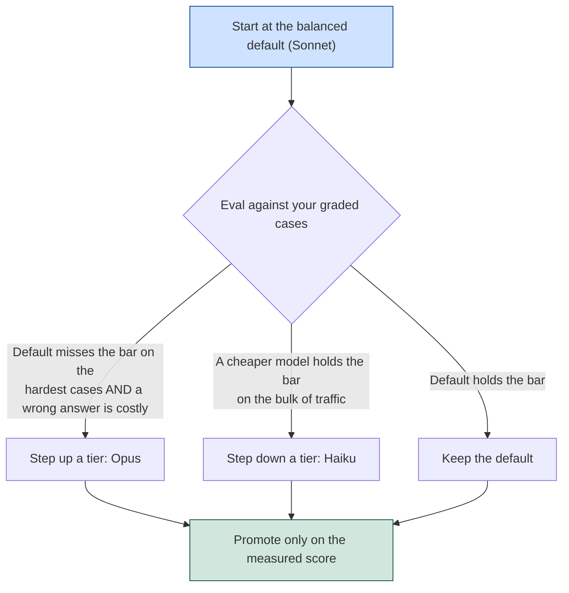

Cost management optimizes spend *within* a chosen model. Model selection sets the baseline that optimization works from — it is the decision that determines which model runs the workload in the first place. Picking it by reflex ("use the strongest model to be safe") is the most common and most expensive model-selection mistake in production, because it pays top-tier per-token cost and latency on every request whether or not the task needs them.

This page is the production counterpart to the generation-layer theory in [Generation Systems for RAG](/ai/llm/rag/generation-systems-for-rag): there, model selection is an engineering choice in the generation stage; here, it is a repeatable process for choosing and routing a model across a live workload, gated by an [eval](/ai/agentic-system/evaluation).

## The Latency, Cost, and Quality Trade-off

A model family trades three things against each other, and moving between tiers moves all three at once:

- **Upgrading a tier** buys quality at the price of higher per-token cost and usually higher latency.
- **Downgrading a tier** buys speed and lower cost at the risk of a quality drop.
- A higher tier can occasionally be *faster and cheaper* if it reaches a correct conclusion in fewer tokens than a lower tier would spend flailing.

The decisive term people leave out is the **cost of a mistake**. Saving a few dollars a day on a cheaper model is not a sound trade if the quality drop introduces errors that carry significant downstream cost — a wrong extraction that corrupts records, a bad recommendation that erodes trust. There is no globally correct choice, only the right choice for a specific task at a specific quality bar. The discipline is to make the trade-off *measurable* rather than reaching for the most capable model by default.

## The Mental Process: Default, Then Move on Evidence

Treat model choice as a lever you set per workload and change without rewriting the application. The repeatable process is a default plus two eval-gated moves:



- **Start at the balanced default.** Most production workloads begin on the mid-tier model (Sonnet in the current Claude lineup) because it covers the majority of tasks at a reasonable cost and latency.
- **Step up only when an eval shows the default missing the bar** on the hardest cases your traffic actually contains, *and* the cost of a wrong answer there is high. A multi-step agent where an early wrong step is expensive is the classic case for the top tier (Opus).
- **Step down only when an eval shows a cheaper model holding the bar** on the bulk of traffic. A high-volume classification step where a small, fast model (Haiku) still clears the quality bar is the classic case for trading capability for cost-at-volume.

In both directions the **eval is the instrument**: a model change is promoted on a measured score against your cases, not on intuition. This is why the eval you build for output quality is also the gate for a model decision, and it connects to the [delta-threshold release gates](/ai/agentic-system/prompting-vs-agentic-prompting#evaluations-that-actually-gate-releases) that make any model or reasoning-effort change defensible instead of a guess.

:::note[Verify the current model lineup]

Model family names, tier ordering, and model IDs change over time. Confirm the current lineup and identifiers against the provider's documentation before pinning a model in configuration — the *process* here is stable even when the specific names are not.

:::

## Routing: A Default Model with an Override on a Signal

A system does not have to use one model for everything. A common production pattern is a **default plus an override**: route the bulk of traffic to a balanced default, and send specific request types to a larger or smaller model based on a cheap signal read from the request — task type, input length, or a difficulty classification.

```python
def choose_model(request):
    if request.task_type == "complex_synthesis":
        return "opus"       # pay for the top tier only where it is needed
    if request.input_len < SHORT:
        return "haiku"      # cheap, fast path for simple lookups
    return "sonnet"         # balanced default for everything else
```

This is the same routing idea used for [retrieval strategy](/ai/agentic-system/testing-and-tracing#routing-between-strategies-is-a-seam-you-still-have-to-test), applied to model choice: you pay for the more capable model only on the requests that need it. And it carries the same caveat — the router is a new seam. The `classify -> model` decision needs an integration test (does each request class reach the tier it should?) and a trace field (which model ran), or a misrouted request silently answers on the wrong tier. Where every request is the same shape, skip the router and pin one model.

In a multi-agent setup the routing logic extends naturally: use a more capable model as the lead and cheaper models for the parallel sub-agents, so you are not paying top-tier rates across every context. That specific trade-off, and the token multiplier that makes it matter, is covered in [Agent-to-Agent Communication](/ai/agentic-system/agent-to-agent#the-cost-of-orchestration-a-token-multiplier-not-a-free-speedup).

## Where This Sits

Model selection sets the baseline; the surrounding pages tune within it. [Cost, Latency, and Reliability](/ai/agentic-system/production/cost-latency-reliability) models the budget once the tier is chosen; [Caching](/ai/agentic-system/caching) and [Rate Limits and Failure Handling](/ai/agentic-system/rate-limit) reduce the cost and harden the calls to whichever model you picked; and [Evaluation](/ai/agentic-system/evaluation) is the gate that makes every step-up or step-down a measured decision rather than a preference.
