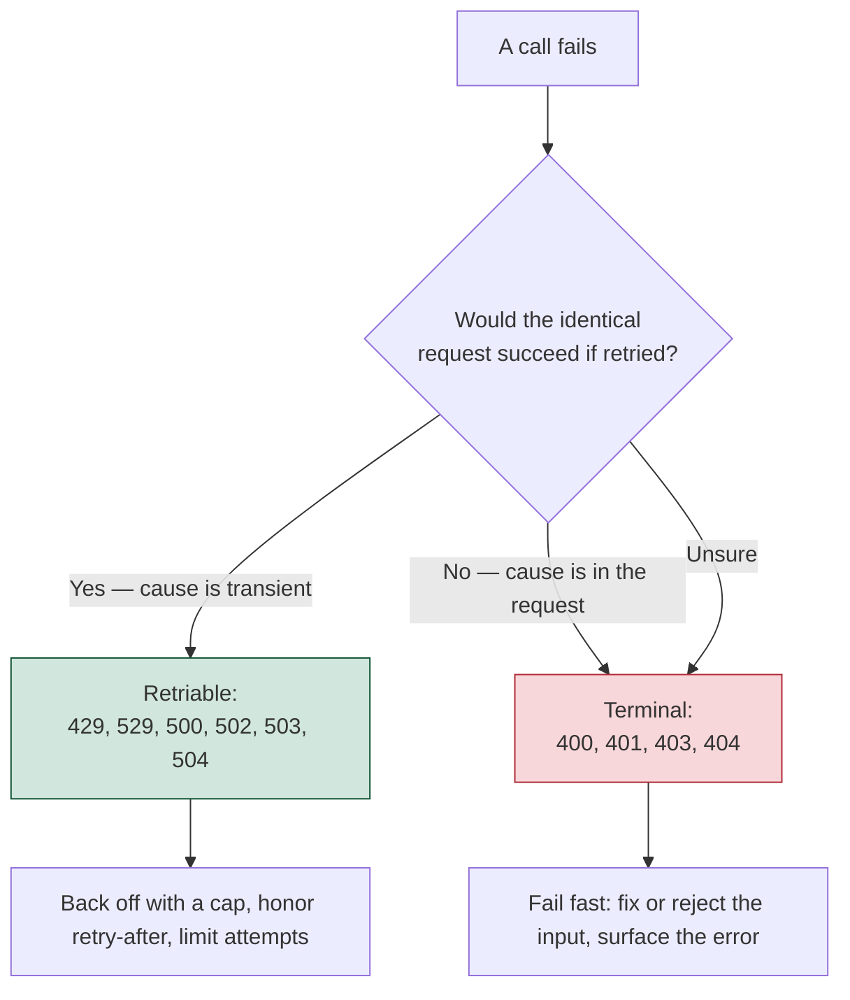

When working with large language models (LLMs), especially from cloud-based providers like OpenAI or Anthropic, you'll inevitably face **rate limits** — hard constraints on how frequently or quickly your application can interact with the provider's API. These limits are imposed to ensure fair resource distribution and infrastructure stability.

This blog post walks you through best practices for managing rate limits using [LangChain’s chat model utilities](https://python.langchain.com/docs/how_to/chat_model_rate_limiting/). We’ll explain the types of rate limits that exist, introduce the two primary rate limiting utilities LangChain provides, compare them side by side, and show you practical, real-world examples of how to apply each approach effectively in your applications.

Whether you're building a simple chatbot or a complex pipeline composed of multiple LLM-enabled tools, mastering rate limiting will help you avoid errors, improve responsiveness, and reduce the likelihood of provider throttling.

## What Are Rate Limits?

Rate limits are restrictions placed on how many requests or tokens your application can send to a large language model API in a given time window. These limits are enforced by providers like OpenAI and vary based on model, tier, and usage patterns.

According to OpenAI, the following five rate limit metrics are currently tracked and enforced:

| Metric                        | Description                                                                 |
| ----------------------------- | --------------------------------------------------------------------------- |
| **Requests per minute (RPM)** | Number of API calls allowed per minute                                      |
| **Tokens per minute (TPM)**   | Total tokens sent and received across all calls per minute                  |
| **Requests per day (RPD)**    | Daily limit on the number of API requests (especially for free/early plans) |
| **Tokens per day (TPD)**      | Total tokens allowed per day across requests                                |
| **Images per minute (IPM)**   | Number of image generation requests allowed per minute (e.g. DALL·E)        |

These limits ensure quality of service across the platform. In practice, exceeding them will trigger errors (like HTTP 429) or timeouts. They are typically enforced at the organization level and may also be quantized over short periods (e.g. per second) to avoid traffic bursts.

## Two Ways to Handle Rate Limits in LangChain

LangChain offers two built-in rate limiter classes, each tailored to different usage patterns and architectures:

- `RateLimiter` (Utility-Based)
    - Found in: `langchain.utils.rate_limit`
    - Designed for simple integration with a model
    - Great for direct API calls and standalone use cases
    - For more information, check LangSmith [Chat models](https://python.langchain.com/docs/concepts/chat_models/#standard-parameters)
- `InMemoryRateLimiter` (Runnable-Based) 
    - Found in: `langchain_core.rate_limiters`
    - Built for `Runnable` pipelines
    - Perfect for workflows involving prompts, retrievers, evaluators, or other steps
    - For more information, check LangSmith [How to handle model rate limits](https://docs.smith.langchain.com/evaluation/how_to_guides/rate_limiting)


Choosing the right limiter depends on whether your app uses basic model calls or LangChain's composable pipeline system. Below is the side-by-side comparison highlights where each option shines.


| Feature                        | `RateLimiter`                | `InMemoryRateLimiter`                                        |
| ------------------------------ | ---------------------------- | ------------------------------------------------------------ |
| **Module**                     | `langchain.utils.rate_limit` | `langchain_core.rate_limiters`                               |
| **Design**                     | Utility-based                | `Runnable`-based (fits in pipelines)                         |
| **Integration with LangChain** | Moderate — wraps model calls | High — integrates with chains, retrievers, tools             |
| **Thread Safety**              | Yes                          | Yes                                                          |
| **Process Safety**             | No (local memory only)       | No (local memory only)                                       |
| **Burst Control**              | Yes (via `max_bucket_size`)  | Yes (via `max_bucket_size`)                                  |
| **Ideal Use Case**             | Direct model interaction     | Composing multi-step workflows or chaining custom components |

## Code Demo

### Using `RateLimiter` with a Chat Model

This is the simplest and quickest way to add rate limiting to your application. It wraps around the model object and regulates how often the model is called.

```python
from langchain.chat_models import ChatOpenAI
from langchain.utils.rate_limit import RateLimiter

rate_limiter = RateLimiter(max_calls=5, period=1)  # 5 requests per second
chat = ChatOpenAI(rate_limiter=rate_limiter)

response = chat.invoke("Tell me a joke")
```

This approach is ideal for scripting, fast experimentation, or building lightweight apps where only the LLM call needs regulation.

###  Using `InMemoryRateLimiter` with Runnable Chains

In more complex LangChain apps, you often build pipelines using `Runnable` components. These might include prompt templates, tool wrappers, or retrieval chains. `InMemoryRateLimiter` fits naturally into this setup.

```python
from langchain_core.prompts import ChatPromptTemplate
from langchain_openai import ChatOpenAI
from langchain_core.rate_limiters import InMemoryRateLimiter

prompt = ChatPromptTemplate.from_template("Tell me a joke about {topic}")
model = ChatOpenAI()
rate_limiter = InMemoryRateLimiter(requests_per_second=2)

# Compose chain with rate limiter applied
chain = prompt | rate_limiter | model

response = chain.invoke({"topic": "cats"})
print(response)
```

By placing the rate limiter between components, it controls request pacing across the entire chain — not just at the LLM call. This is essential when multiple components might trigger requests.

### Retry with Backoff Using `max_retries`

Even with throttling, you may encounter rate limit errors during high traffic. Many LangChain models expose a `max_retries` parameter for automatic retrying:

```python
from langchain.chat_models import ChatOpenAI

chat = ChatOpenAI(max_retries=3)  # Retries up to 3 times with backoff
```

:::info Using `tenacity`, if you're not using `langchain`
If you're not using `langchain` you can use other libraries like `tenacity` (Python) or `backoff` (Python) to implement retries with exponential backoff, or you can implement it from scratch. See some examples of how to do this in the [OpenAI docs](https://platform.openai.com/docs/guides/rate-limits#retrying-with-exponential-backoff).
```python
from tenacity import (
    retry,
    stop_after_attempt,
    wait_random_exponential,
)  # for exponential backoff

@retry(wait=wait_random_exponential(min=1, max=60), stop=stop_after_attempt(6))
def completion_with_backoff(**kwargs):
    return client.chat.completions.create(**kwargs)


completion_with_backoff(model="gpt-4o-mini", messages=[{"role": "user", "content": "Once upon a time,"}])
```
```python
ChatCompletion(id='chatcmpl-8PAu6anX2JxQdYmJRzps38R8u0ZBC', choices=[Choice(finish_reason='stop', index=0, message=ChatCompletionMessage(content='in a small village nestled among green fields and rolling hills, there lived a kind-hearted and curious young girl named Lily. Lily was known for her bright smile and infectious laughter, bringing joy to everyone around her.\n\nOne sunny morning, as Lily played in the meadows, she stumbled upon a mysterious book tucked away beneath a tall oak tree. Intrigued, she picked it up and dusted off its weathered cover to reveal intricate golden patterns. Without hesitation, she opened it, discovering that its pages were filled with magical tales and enchanting adventures.\n\nAmong the stories she found, one particularly caught her attention—a tale of a long-lost treasure hidden deep within a mysterious forest. Legend had it that whoever found this hidden treasure would be granted one wish, no matter how big or small. Excited by the prospect of finding such treasure and fulfilling her wildest dreams, Lily decided to embark on a thrilling journey to the forest.\n\nGathering her courage, Lily told her parents about the magical book and her quest to find the hidden treasure. Though concerned for their daughter\'s safety, they couldn\'t help but admire her spirit and determination. They hugged her tightly and blessed her with love and luck, promising to await her return.\n\nEquipped with a map she found within the book, Lily ventured into the depths of the thick forest. The trees whispered tales of forgotten secrets, and the enchanted creatures hidden within watched her every step. But Lily remained undeterred, driven by her desire to discover what lay ahead.\n\nDays turned into weeks as Lily traversed through dense foliage, crossed swift rivers, and climbed treacherous mountains. She encountered mystical beings who offered guidance and protection along her perilous journey. With their help, she overcame countless obstacles and grew braver with each passing day.\n\nFinally, after what felt like an eternity, Lily reached the heart of the forest. There, beneath a jeweled waterfall, she found the long-lost treasure—a magnificent chest adorned with sparkling gemstones. Overwhelmed with excitement, she gently opened the chest to reveal a brilliant light that illuminated the forest.\n\nWithin the glow, a wise voice echoed, "You have proven your courage and pure heart, young Lily. Make your wish, and it shall be granted."\n\nLily thought deeply about her wish, realizing that her true treasure was the love and happiness she felt in her heart. Instead of making a wish for herself, she asked for the wellbeing and prosperity of her village, spreading joy and harmony to everyone living there.\n\nAs the light faded, Lily knew her quest was complete. She retraced her steps through the forest, returning home to find her village flourishing. Fields bloomed with vibrant flowers, and laughter filled the air.\n\nThe villagers greeted Lily with open arms, recognizing her selflessness and the magic she had brought into their lives. From that day forward, they told the tale of Lily\'s journey, celebrating her as a heroine who embodied the power of love, kindness, and the belief that true treasure lies within oneself.\n\nAnd so, the story of Lily became an everlasting legend, inspiring generations to follow their dreams, be selfless, and find the true treasures that lie within their hearts.', role='assistant', function_call=None, tool_calls=None))], created=1701010806, model='gpt-3.5-turbo-0613', object='chat.completion', system_fingerprint=None, usage=CompletionUsage(completion_tokens=641, prompt_tokens=12, total_tokens=653))
```
:::


## Fallback to a Backup Model

Another powerful technique is switching to a secondary model if your primary provider is throttled or down:

```python
from langchain.chat_models import ChatOpenAI, ChatAnthropic

try:
    response = ChatOpenAI().invoke("What's the weather in London?")
except Exception as e:
    print("Fallback triggered due to:", e)
    response = ChatAnthropic().invoke("What's the weather in London?")
```

This ensures uptime and responsiveness, especially in production applications.

## Additional Tips

Here are a few extra strategies to maximise performance and resilience:

- **Batching**: Consolidate multiple inputs into fewer API calls using `map_reduce` or similar techniques.
- **Streaming**: For long responses, streaming tokens reduces overall token usage and improves perceived latency.
- **Parallelisation**: Use with caution — multiple concurrent keys may violate terms of service.
- **Monitoring**: Track error types, retry rates, and cache effectiveness to guide optimisations.

## Concurrency and Batch Processing

Two patterns address high-volume work, and they solve genuinely different problems, so it's worth separating them from the throttling utilities above.

The first is **non-blocking concurrency**. An async client (for example `AsyncAnthropic` in the Python SDK, or the standard Promise-based client you `await` in the TypeScript SDK) issues API calls without tying up the application thread, so your program can do other work while a request is in flight. The request still returns in real time — the point is only that waiting on it does not block everything else. This is the right pattern when you need to run many requests concurrently and each result is still wanted promptly.

The second is **offline batch processing**. The Message Batches API is a separate mechanism for bulk workloads where no user is waiting on any single result: you submit a large set of requests in one call, receive an identifier, and poll for completion. Batch jobs can take up to 24 hours and run at a lower per-token cost in exchange for that latency, which makes them a good fit for evaluation runs, offline pipelines, and bulk jobs where cost matters more than turnaround. The sizing implication is that a workload whose SLA tolerates delay can often move to batch and pay noticeably less — the same trade-off flagged in [Feasibility and Use-Case Sizing](/ai/agentic-system/production/feasibility-and-sizing#sizing-a-use-case).

:::note[Verify current batch limits]

The 24-hour completion window and the batch discount are provider-specific and change over time. Confirm the current figures against the provider's documentation before committing a workload to batch processing.

:::

## Retriable vs Terminal Failures

Rate limits are one member of a larger family: the failures production throws that development never shows. A prototype called a few dozen times on a stable connection rarely hits a rate limit, a timeout, a transient network drop, or a malformed response under load — so the code that handles them never gets written, and the first failure surfaces as an unhandled exception in production. The decision that organizes all of this is a single question asked of every failure: **would waiting and trying the exact same request again plausibly work?**



If a later attempt is likely to succeed, the failure is **retriable**: the cause is transient — the service was briefly over capacity, a connection dropped, a per-minute limit was momentarily exceeded. If retrying the identical request changes nothing, the failure is **terminal**: the cause is in the request itself — a malformed body, an expired key, a model name that does not exist. On the Anthropic API the status code names the bucket: a `429` (rate limit) and a `529` (overloaded) are retriable, `5xx` server errors typically clear on retry, while a `400` (bad request), `401` (auth), and `403` (permissions) are terminal.

```python
RETRIABLE = {429, 529, 500, 502, 503, 504}  # rate limit, overload, transient
TERMINAL  = {400, 401, 403, 404}            # bad request, auth, missing

def is_retriable(status):
    return status in RETRIABLE  # everything else fails fast
```

Correct classification is what preserves the retry budget for the failures that actually need it. Retrying a terminal error wastes attempts and hides the real problem behind a wall of identical failures; when unsure, the safe default is to treat an error as terminal and raise it, because a failure wrongly marked terminal fails loudly and gets fixed, while one wrongly marked retriable hammers a service and deepens the problem.

### Honoring `retry-after` Before Falling Back to Backoff

The API returns rate-limit headers on each response, and the most useful is `retry-after`, included on a `429` or `529` to say exactly how long to wait before trying again. Honoring that value is more precise than guessing with backoff alone, because the service is telling you when capacity returns — so the correct order is to read `retry-after` first and fall back to exponential backoff only when the header is absent.

One caution before writing a retry loop by hand: the Anthropic client libraries **already retry** transient failures with progressive delays, up to a configurable number of attempts. Wrapping your own retry loop around the SDK's retries multiplies attempts against the same limit instead of capping them. Decide where the retry lives — let the SDK own transient cases and reserve your code for application-specific fallbacks, or turn the SDK retries down and own the full path — but do not run both unaware of each other.

The defect this prevents is a tight loop that retries everything, instantly:

```python
def call_with_retry(make_call, max_attempts=5):
    for attempt in range(max_attempts):
        try:
            return make_call()
        except Exception:
            time.sleep(0)            # defect: no backoff, retries fire instantly
    raise RetryBudgetExhausted()      # also retries terminal errors like 400
```

Against a rate limit, each instant retry counts as another request and deepens the limit rather than waiting for it to clear; retrying a `400` does nothing but burn the budget. The corrected version honors `retry-after`, grows a capped backoff interval between attempts, and fails fast on terminal statuses:

```python
def call_with_retry(make_call, max_attempts=5, cap=30):
    for attempt in range(max_attempts):
        try:
            return make_call()
        except anthropic.RateLimitError as e:
            wait = e.response.headers.get("retry-after")
            if wait is None:
                wait = min(cap, 2 ** attempt) + random.uniform(0, 1)
            time.sleep(float(wait))
        except anthropic.APIStatusError as e:
            if not is_retriable(e.status_code):
                raise                 # fail fast on terminal
            time.sleep(min(cap, 2 ** attempt) + random.uniform(0, 1))
    raise RetryBudgetExhausted()
```

### Surfacing Tool Errors to the Model

A related failure is quieter because nothing raises. When your code runs a tool and the tool fails, the result should go back to the model with `is_error` explicitly set — not as a silent empty result. This is not automatic: a handler that swallows the exception and returns nothing leaves the model treating the empty result as valid data and reasoning confidently on top of a false premise, which produces a wrong answer that is far harder to catch than a visible failure.

```python
def run_tool(tool_use):
    try:
        result = execute(tool_use)
        return {"type": "tool_result", "tool_use_id": tool_use.id, "content": result}
    except Exception as e:
        # surface the error so the model can react; do NOT return empty
        return {"type": "tool_result", "tool_use_id": tool_use.id,
                "is_error": True, "content": f"Tool failed: {e}"}
```

With `is_error` set, the model knows the tool failed and can change approach, ask for clarification, or stop. One related case sits outside the status-code model entirely: a refusal arrives as a `200` at the HTTP layer with `stop_reason: "refusal"`, so the retriable classifier never sees it — treat it as terminal, raise it, and log it rather than silently retrying.

:::note[Verify status codes and headers]

The specific retriable/terminal status codes, the `retry-after` header name, and refusal signaling are provider- and version-specific. Confirm them against the current API reference before relying on them in a retry path.

:::

This failure-handling layer is where a localized failure from [Testing and Tracing](/ai/agentic-system/testing-and-tracing#tracing-finding-the-step-that-failed) becomes a recovery decision, and it is one of the four decisions captured in the [production-hardening design document](/ai/agentic-system/production#the-production-hardening-design-document).

## Final Thoughts

Rate limiting is not just a technical constraint — it's a design consideration. Choosing the right strategy for your LangChain app can make the difference between smooth, resilient performance and frustrating bottlenecks.

If you’re calling LLMs frequently or chaining components together, make rate control a first-class concern. Combine strategies like caching, exponential backoff, fallback models, and thoughtful batching to ensure your app remains stable and cost-efficient.

For even more robustness, pair these approaches with monitoring tools like LangSmith, and run load tests before scaling up.

With the right rate limiting setup in place, your LLM-powered applications will be well-prepared for production traffic and evolving usage patterns.

