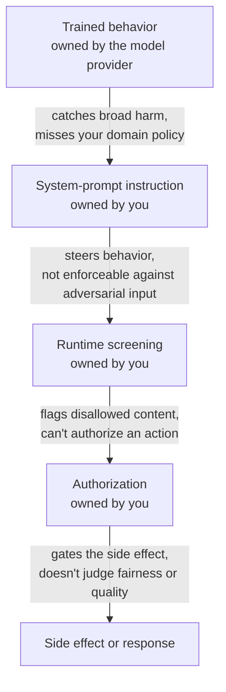
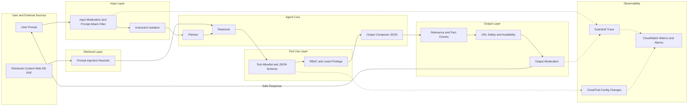
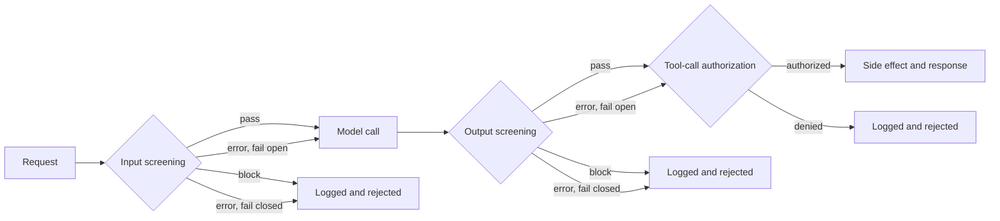
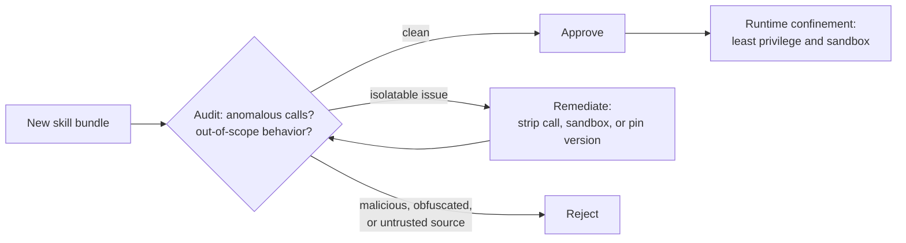

# Safeguarding Agentic Systems

Agentic systems (plan, retrieve, call tools, act) are high-leverage—and high-risk. This guide distills **defense-in-depth** patterns you can ship today, mapping conceptual guardrails to concrete implementation (especially on AWS Bedrock).

## What the Model Enforces vs. What You Own

Before adding any guardrail, it helps to know how much safety is already handled upstream versus what your application still has to build. Treat safety as four layers stacked outward from the model — each one covers something the layer below it cannot, and each fails in a way the next layer has to catch.

Reading the stack top to bottom makes the hand-off explicit: each layer's blind spot is exactly what the next layer exists to catch.



Only the top layer belongs to the model provider — everything below it is something you design, version, and test yourself.

| Layer | What it reliably covers | What it does not cover | Who owns it |
| --- | --- | --- | --- |
| Trained behavior | Broad classes of harmful or unsafe output, applied to every request without configuration | Your domain policy, your data rules, your authorization model | The model provider |
| System-prompt instruction | Role, tone, and stated constraints that steer the model inside one request | Anything an adversarial or unusual input can talk the model out of — instructions are not enforcement | You (the architect) |
| Runtime screening | Input and output screening that detects disallowed content | Actions with side effects, which screening does not authorize, and novel attacks a classifier misses | You |
| Authorization | Whether a specific action with a side effect is permitted for this caller in this context | Content quality and fairness | You |

:::note[How this is framed on Anthropic's platform, for reference]
Anthropic trains Claude against a published "constitution" — a document that sets a priority order for conflicting goals: be broadly safe, be ethical, comply with guidelines, and be genuinely helpful to operators and users. That ordering is holistic rather than a rigid sequence, but higher-priority goals generally win when they conflict. The most recent published revision is from January 2026 — verify the current version before citing it.
:::

The practical failure mode is assuming the top layer already covers a rule it never saw. A request to view another business unit's records can look completely unremarkable in general terms — nothing about it resembles a broadly harmful request — so trained behavior has no reason to refuse it. If the application never supplies and enforces that unit boundary itself, nothing in any layer stops the disclosure. Tenant isolation, refund limits, approved scripts, and sign-off rules are deployment-specific policy, and deployment-specific policy is always something you build, not something trained behavior already contains.

## Threats → Layers → Controls (one mental model)

**Direct** prompt injection (user tries to jailbreak) and **indirect** prompt injection (malicious text inside webpages/PDFs/KB) are the core threats. Design countermeasures at each choke point—**Input, Retrieval, Tool Use, Output, Observability**—so one miss doesn’t become a breach.

**Guardrail Layers vs Threats**

| **Layer**         | **What It Protects**                   | **Threats Mitigated**                                          | **Typical Controls**                                                                           |
| ----------------- | -------------------------------------- | -------------------------------------------------------------- | ---------------------------------------------------------------------------------------------- |
| **Input**         | User prompts & uploads                 | Direct prompt injection; illegal/toxic content; PII            | Dual moderation (input), Prompt-Attack filter, instruction isolation, rate limits              |
| **Retrieval**     | External/KB text fed to the LLM        | Indirect prompt injection; hidden instructions; malicious HTML | Sanitize HTML/scripts; allow/deny domain lists; PI heuristics; “facts-only” summarization      |
| **Tool Use**      | APIs/DBs/emails the agent can call     | Unauthorized actions; data exfiltration                        | Tool allowlist; JSON-schema validation; RBAC/IAM scoping; human-in-the-loop for sensitive ops  |
| **Output**        | What reaches users or triggers actions | Harmful/off-topic/false responses; jailbreak leakage           | Dual moderation (output); relevance & fact-check validators; URL checks; schema-locked results |
| **Observability** | Posture & drift                        | Silent bypass; misconfig                                       | Guardrail trace; CloudTrail on config changes; CloudWatch dashboards/alerts; anomaly detection |

**Defense-in-Depth Flow**



### The Recurring Risk Categories

Most of what a guarded path defends against falls into five recurring categories, and naming them explicitly is what turns "add some guardrails" into an actual design:

1. **Direct prompt injection** — a user crafts input that overrides the system's instructions and redirects its behavior.
2. **Indirect prompt injection** — malicious instructions arrive through retrieved content or tool outputs that the model treats as trusted, and input screening alone never sees them.
3. **Token-budget exhaustion** — oversized or adversarially padded inputs consume the context or output budget, truncating work or inflating cost.
4. **Tool and action abuse** — the model is induced to call a side-effecting tool outside policy.
5. **Data exposure** — sensitive fields enter the context window or the logs where they shouldn't, independent of anything the model itself did wrong.

:::info[Are guardrails just risk prevention?]
Essentially, yes. These five categories are the threats; the guardrail layers in the table above are the runtime controls that prevent or contain each one, and the mapping is close to 1:1 — input screening counters direct injection, screening retrieved content and tool output counters indirect injection, token/turn caps counter budget exhaustion, action authorization counters tool abuse, and redaction counters data exposure. [OWASP's GenAI Top 10](https://genai.owasp.org/) organizes its own list the same way — a named risk paired with a named mitigation — which makes it a useful cross-check against whatever threat model a design already covers.
:::

A full risk assessment walks the whole path these threats travel — user input, retrieved content, tool output, model output, side effects, and logs — and records, for each identified risk, its likelihood, impact, mitigation, owner, and evidence. That record is what a security reviewer signs off on, not a verbal description of "guardrails being in place."

## Guardrails in practice (catalog + visuals)


Source: [datacamp: Top 20 LLM Guardrails With Examples](https://www.datacamp.com/blog/llm-guardrails)

Guardrails fall into five major categories. Each maps to different risks in an agentic system, and each can be implemented with either **managed services** (like Bedrock Guardrails) or **custom validators** (LangChain/LangGraph nodes, regex, or lightweight LLMs).

### 🔒 Security & Privacy

These guardrails protect against unsafe or unauthorized content entering or leaving your system. They typically include filters for toxic or offensive language, detection and redaction of personally identifiable information (PII), and prompt injection shields.
**Example:** Bedrock Guardrails can redact phone numbers from user input before the model sees them. In custom stacks, you might run Microsoft Presidio to flag SSNs or emails.

### 🎯 Response & Relevance

Even if an LLM is polite, it can still drift off-topic or fabricate irrelevant details. Response validators ensure the model answers the question asked, provides citations, and that any URLs it includes actually resolve.
**Example:** Compute cosine similarity between the input query embedding and the generated answer embedding to reject “off-topic” answers. Use a simple HTTP HEAD request to verify URLs.

### 📝 Language Quality

Output should be clear, professional, and free from low-quality artifacts. Language quality guardrails detect duplicated sentences, ensure readability is within a target level, and verify translations are accurate.
**Example:** A validator LLM grades readability (e.g., “Is this answer clear for a non-technical reader?”) or detects if the model output accidentally repeated a phrase 3+ times.

### ✅ Content Validation & Integrity

These controls verify that structured claims in the output are consistent, accurate, and safe to show. They block competitor mentions, check price quotes against a pricing API, or confirm that references exist in the knowledge base.
**Example:** If the model claims “The ticket price is \$125,” a content validator can query the official API and refuse to pass through mismatched values.

### ⚙️ Logic & Functionality

Finally, logic guardrails focus on whether the model’s structured outputs are valid for downstream use. This includes schema validation for JSON tool calls, logical flow checks (e.g., “departure time can’t be after arrival time”), and OpenAPI response validation.
**Example:** Use a JSON schema to validate tool calls—if invalid, reject or repair with a repair-prompt before invoking the tool.


## Inputs & Retrieval as a single gate (stop junk early)

**Dual moderation + instruction isolation** at ingress prevents a lot of nonsense. For RAG, treat retrieved text as **untrusted code**:

* Strip scripts/HTML, drop base64 blobs, kill `<style>`/hidden text.
* Run **PI heuristics** (regex + small LLM) and **quarantine or summarize to facts**.
* Maintain allow/deny domain lists; attribute sources for later fact checks.


Source: [AWS: Safeguard your generative AI workloads from prompt injections](https://aws.amazon.com/blogs/security/safeguard-your-generative-ai-workloads-from-prompt-injections/)

## Tool calls & outputs (where incidents actually happen)

Tool invocation is the riskiest part of an agentic system because it can create real-world effects — from sending an email to deleting a database record. That means the model’s freedom must be tightly constrained:

* **Tool allowlist + JSON schema lock**
  Only expose a curated set of tools, and validate every tool call against a strict schema. Reject or repair malformed calls before they touch an API.
  *Example:* A payment tool that expects `{"amount": 100, "currency": "USD"}` will reject `{ "amount": "delete all" }`.
* **RBAC/IAM per tool**
  Scope each tool to the minimum privileges it needs. Even if a malicious prompt slips through, IAM boundaries prevent escalation.
  *Example:* A “Calendar read” tool role should never have `DeleteEvent` permission.
* **Human-in-the-loop (HITL)**
  Route sensitive operations (fund transfers, account deletions) to a manual approval queue.
  *Example:* Wire transfers require operator confirmation before execution.
* **Output validators before commit**
  Don’t trust the model blindly. Run relevance checks, fact validation, URL availability checks, and readability scoring before persisting results or invoking tools.
## The Full Guarded Request Path

A guarded request path has three distinct control points, each answering a different question. Laid out as a flow, the branch at every gate becomes explicit — each one either continues forward or logs and stops the request, and a path only continues past a failed gate when fail-open was deliberately chosen:



The one arrow that must never have a way around it is the one leading to a side effect — authorization sits immediately before it, with no bypass path. The order of the other two gates can vary with the workflow, but every gate — pass, block, or fail — gets logged so an incident can be reconstructed afterward.

### Matching Check Type to the Question

| Control point | A model-based check fits when | A deterministic check fits when |
| --- | --- | --- |
| Input screening | Intent is ambiguous — catching jailbreak or injection patterns too varied to enumerate as rules | The rule is exact and defined: a blocklist, a regex, a length or format check |
| Output screening | Judging a quality like toxicity or policy compliance that needs language understanding | Checking for a known string, a forbidden field, or a schema violation |
| Tool-call authorization | Rarely — authorization should be provable and replayable | Almost always: an allowlist, an identity check, and scope validation |

A model-based classifier can be evaded — a user can phrase input to slip past even a strong judge model. A deterministic rule is brittle in the opposite direction — it blocks exactly what it was programmed to catch and nothing else, and over-blocks anything that merely resembles a restricted pattern. Neither catches everything alone, which is why they're chained in series: each one's known gap gets covered by a control of the other kind, deliberately, rather than left open.

Authorization specifically should stay deterministic even when it feels like it needs judgment — a model-based judgment call can't be replayed later as proof of who was allowed to act, and "who may issue a refund" is exactly the kind of decision that has to be auditable, not interpreted.

### A Second Injection Vector: Retrieved Content and Tool Output

Input screening only inspects what the user sends directly — it has no visibility into instructions that enter the context later, through retrieved documents or tool responses. In a RAG system, a malicious instruction planted in a retrieved document reaches the model *after* input screening has already passed the request; in an agentic system, the model tends to treat tool output as authoritative by default. This is the dominant injection vector in enterprise deployments that use retrieval or tools, and it is a coverage gap, not a weak classifier — name it explicitly in the control design. The fix is the same control placed a second time: run the same model-based classifier over retrieved content and tool output before either is appended to the model's context.

:::note[Reading a refusal programmatically, for reference]
On Anthropic's Messages API, a streaming classifier intervention returns `stop_reason: "refusal"` with a `stop_details` object carrying a policy category plus an explanation (both null if the refusal doesn't map to a named category). As of this writing the category set includes `cyber`, `bio`, `frontier_llm`, and `reasoning_extraction` — re-check the current list rather than hardcoding it, and tolerate an absent `stop_details` on models that don't return one. After a refusal, reset or rephrase the triggering turn before continuing; resending the same refused context tends to produce further refusals.
:::

### Fail Open vs. Fail Closed

Specify in advance how an *operator-owned* guardrail behaves when the guardrail itself breaks — times out, errors, or goes unreachable under load. There are only two choices, and if the design doesn't state one explicitly, the surrounding code picks one by accident, and the accidental default is almost always fail open.

| | Behavior when the guardrail breaks | Result |
| --- | --- | --- |
| Fail open | Traffic passes through unscreened | The application keeps working; protection is silently gone |
| Fail closed | Further actions are blocked until the control recovers | The application degrades; protection holds |

Fail open is the more dangerous default precisely because it's invisible — the architecture diagram still shows a guardrail box, so the system gets the reassurance of a control with none of its protection. High-impact or irreversible paths should fail closed and emit an operational event when they do. This applies only to the controls an application operates; a provider's built-in model safety behavior isn't operator-configurable and doesn't fail open. It's the same reasoning as a [circuit breaker](/ai/agentic-system/production/cost-latency-reliability#reliability-controls-what-sits-where) — when a dependency is failing, degrade deliberately, rather than inheriting whatever an error handler happens to do by default.

### Why One Output Filter Is Not a Guarded Path

A side-effecting tool call and a block of generated text are judged by different controls, and conflating them is a common design gap: a workflow that screens nothing on the way in, lets the model invoke an unguarded financial tool, and checks only the final text has exactly one control, sitting downstream of the one action on the path that can't be undone. An output classifier cannot undo a refund that already ran. Input screening, output screening, and action authorization each answer a different question — one filter at the end of the path does not cover the other two.

## The Minimal Secure Agent Configuration

The reliable boundary for an agent that reads untrusted content is not in the text — it is in what the agent is *allowed to do* regardless of what the text says. Model-level defenses matter but are probabilistic: Anthropic both trains the model to recognize and refuse injected instructions and runs classifiers over untrusted content, and is explicit that no agent reading untrusted content is fully immune. So the application must defend the action boundary too. For a representative agent — one that fetches untrusted web content and writes to a single protected path under a scoped identity — the minimal configuration is **four controls, each enforcing one thing**:

| Control | What it enforces |
| --- | --- |
| **`PreToolUse` hook on a lifecycle event** | Runs *before* the tool executes and denies a `write_file` whose path is outside the permitted output directory — an enforced boundary, not a prompt instruction. |
| **Deny rule** | Explicitly blocks sensitive paths (`/etc`, `/secrets`, `~/.aws`) regardless of any allow rule, so a steered agent cannot reach them. |
| **Secret reference from the environment** | Reads `os.environ["SERVICE_API_KEY"]` rather than a committed value, so the credential can be rotated and never enters repository history. |
| **Audit-log line on every privileged action** | Records the action, path, and result so the control's evidence exists before a reviewer asks for it. |

```python
# PreToolUse hook: runs before any tool call and can block it
def pre_tool_use(event):
    if event.tool == "write_file" and not event.path.startswith("/workspace/output"):
        log_audit(action="write_file", path=event.path, result="BLOCKED")
        return {"permissionDecision": "deny",
                "permissionDecisionReason": "write outside the permitted path"}
    log_audit(action=event.tool, path=getattr(event, "path", None), result="allowed")
    return {"permissionDecision": "allow"}
```

The reason least privilege is the load-bearing control is that it holds *even when every other defense fails*. Assume an injection gets through the model's training, past the classifiers, and the agent decides to act on the hostile instruction. What happens next is bounded entirely by what the identity may do: if it can write anywhere and read every secret, the injection is an incident; if it can write to one output directory and read only its input, the same injection is a denied action and a log entry. When multiple rules apply, precedence is **deny over ask over allow**, so a single deny is an absolute boundary no allow can widen. OS-level sandboxing (filesystem and network isolation enforced by the operating system, not application logic) is the residual control that holds when a hook is missing or misconfigured — the control enterprise reviewers ask about first.

:::tip[The same boundary in VS Code]

The hook above is Claude Code's mechanism, but the *principle* — enforce, don't instruct — transfers to any coding agent. In VS Code, the equivalent deterministic checkpoints are a coding-agent lifecycle hook where the host exposes one, a formatter/linter/validation task for editor-time feedback, a **Git pre-commit hook** for checks before a commit, a secret scanner (Gitleaks, TruffleHog) in pre-commit and CI, and protected branches with required CI checks before merge. Telling an agent not to write a credential is guidance; mechanically rejecting the change before commit or merge is a control. For a credential already committed, prevention is too late — rotate it, because removing it from the latest file does not remove it from history.

:::

### Worked Example: Three Defects Across Three Layers

Real production failures rarely arrive one layer at a time. The application below runs, but it carries one planted defect per layer — the same cumulative hardening the [design document](/ai/agentic-system/production#the-production-hardening-design-document) exists to prevent:

```python
def answer(question, page_url):
    page = fetch(page_url)                       # untrusted content
    notes = read_file("/workspace/input/notes")
    write_file(page.suggested_path, summarize(page))  # defect 3
    resp = None
    for i in range(5):
        try:
            resp = client.messages.create(model=MODEL, max_tokens=MAX_TOKENS,
                                          messages=msg(question))
            break
        except Exception:
            time.sleep(0)                        # defect 2
    return resp.content[0].text
```

- **Eval / test layer:** there is no eval. Success was judged only by manual demo runs described in the team's notes — not in the code — so there is no graded case to fail a regression when the prompt or model changes. (This is the "where are the demo runs?" trap: the runs live in the story of how it was tested, not in any checkable artifact.)
- **Error-handling / cost layer:** the retry loop retries every exception immediately with `time.sleep(0)` and does not separate terminal errors (a `400`) from retriable ones. Against a rate limit, each instant retry deepens the limit — the fix is the [retriable-versus-terminal path](/ai/agentic-system/rate-limit#retriable-vs-terminal-failures).
- **Security / guardrail layer:** `write_file` uses `page.suggested_path` — a destination taken from untrusted fetched content — with no `PreToolUse` hook enforcing a write boundary. This is the exact failure the four-control configuration above blocks.

Each defect belongs to a different owner in the production cluster, which is why the design document names all four decisions up front rather than discovering them one incident at a time.

## Trust Boundaries Across a Multi-Component Application

A single hardened agent is not the end of the problem. Production systems are usually several **components** wired together — and each wire is a place the boundary can be lost. A component here is any independently running **deployment unit that holds an identity and does work**: the API that orchestrates the workflow, a Claude Code task that fetches and processes content, an MCP server that reaches a customer system, or any microservice, function, or container in the chain. Each runs under *some* identity and can reach *some* resources, which is exactly why each needs scoping.

Two disciplines carry across the whole application:

- **The trust boundary is wherever data or instructions move from one component to another.** Content fetched by a Claude Code task is untrusted when it reaches the next component, so the receiving component must treat it as data, not as instructions — the same principle as the [second injection vector](#a-second-injection-vector-retrieved-content-and-tool-output) above, applied at every seam. The core move is to identify *every* seam as a boundary and not assume a component is trusted just because it worked correctly on its own.
- **Least privilege applies to the application as a whole, not component by component.** Each component operates under an identity, and the application is only as contained as its **most privileged seam** — a single component scoped too broadly becomes the weak point even when every other component is properly scoped. You scope each component to the least privilege its role in the workflow requires, which is what keeps a steered component from reaching beyond its task.

| Component | What it contributes | The trust boundary at its seam | The control that enforces it |
| --- | --- | --- | --- |
| API / orchestrator | Holds the entry point and orchestrates the workflow. | The request entering the app from outside. | Input validation and the identity the call runs under. |
| Claude Code task | Runs the agentic work and may fetch external content. | Content it fetched, which is untrusted downstream. | Treat fetched content as data at the next seam. |
| MCP server | Reaches a customer system to read or act. | The system access it holds on the app's behalf. | Scope the server to least privilege and log the access. |

:::note[MCP is the representative, not the only, external reach]

This map uses an MCP server as the component that reaches external systems, but MCP is not the only way out — a direct [tool call](/ai/agentic-system/model-context-protocol) or an [agent-to-agent](/ai/agentic-system/agent-to-agent) hop reaches the outside world too, and the same boundary and least-privilege rules apply to each. The lesson is not "use fewer agents": more components mean more seams to scope, but each added seam is a *deliberate* boundary to secure, not a reason to avoid decomposition.

:::

Where those components actually run — and the identity each inherits from its platform — is the subject of [Deployment Platform Selection](/ai/agentic-system/production/deployment-platforms), and the per-leg authentication and secret handling is covered in [Enterprise Integration](/ai/agentic-system/production/enterprise-integration).

## Skill Supply-Chain Security

Reusable skills, plugins, and other bundled packages are a different kind of risk from the request-path controls above — they're a supply-chain problem. A skill bundles code with an instruction set and drops it directly into the environment, so malicious logic is baked in *upstream*: input filters and prompt screening only watch the conversation, never the bundle, and output monitoring only catches an effect *after* the code already ran. Defense has to move earlier, into an audit step, because by the time a downstream effect is visible the action has already happened.

**Auditing a skill before it runs** means reading the bundle for two things: **anomalous calls** (network requests, shell execution, filesystem access, credential reads) and **out-of-scope operations** — behavior that doesn't match the job the skill claims to do. A formatting skill that phones home, or a summarizer that writes to disk, is out of scope regardless of how harmless either action looks in isolation. The skill's stated purpose is the audit baseline; anything beyond it is a finding to investigate.

| Finding | Verdict |
| --- | --- |
| Nothing anomalous; everything explained by the stated purpose | **Approve** |
| Isolatable out-of-scope behavior — a stray call, an over-broad permission, a risky version | **Remediate** — strip the call, sandbox the operation, or pin a safer version, then re-audit until it returns approve |
| Malicious logic; the out-of-scope behavior *is* the core mechanism; obfuscated or unauditable; untrusted source | **Reject** |

Every audit needs an explicitly recorded verdict — an unrecorded audit is the same as no audit, since there's no evidence it ever ran, and the record is also what the next version gets re-reviewed against. "Reject" also covers anything that couldn't be audited at all: not finding anything anomalous is not the same claim as there being nothing there.

The audit isn't a one-shot gate — remediation loops back into another audit rather than being a terminal state, and even an approved skill still runs inside runtime confinement afterward:



A clean audit only covers what's in the bundle at review time — a skill that passes review can still reach out at runtime to fetch code that was never in the package that got read. That's why the defense has three layers operating at three different moments, not one:

| Layer | When it acts | What it does |
| --- | --- | --- |
| Trusted-source policy | Standing | A vetted registry, verified publishers, signed releases — shrinks what ever reaches review in the first place |
| Audit | Onboarding, and again per version | Decides what gets in |
| Runtime confinement (least privilege, sandboxing) | Every invocation, including already-approved skills | Contains whatever the audit missed |

These aren't substitutes for one another — a sandbox covers the blind spot an audit can't (code fetched after the fact), and an audit covers what a sandbox's boundary still permits inside it. Least privilege means limited file access, limited network reach, and no standing credentials beyond what the skill explicitly needs. And don't assume a hosting platform vets skills on your behalf — confirm what automated scanning, if any, actually covers, and what it's known to miss.

:::note[Enforcing these controls deterministically]

The trusted-source policy, audit verdict, and least-privilege scoping here are decisions; making them hold at runtime is a separate mechanism. A deterministic hook that fires on every relevant tool call enforces a constraint regardless of what the model decides, which is stronger than an instruction the model may or may not follow — see [Durable Project Context](/ai/agentic-system/durable-project-context#hooks-deterministic-enforcement-at-fixed-points) for the hook-versus-instruction distinction, and [Claude Code Configuration and Permissions](/ai/agentic-system/claude-code-configuration) for the permission modes and deny-rule precedence that sit around these controls.

:::

## Check Your Placement

<details>
<summary><strong>Practical: place four controls on the grid</strong> (click to open)</summary>

Four controls, each answering where it sits on the request path and what kind of check it is. Place each one, then check your reasoning against the answer below.

- **A.** Jailbreak and prompt-injection screen
- **B.** Banned-term blocklist on the user message
- **C.** Toxicity judge on the generated response
- **D.** Refund-authorization policy check before the tool runs

| | Model-based | Deterministic |
| --- | --- | --- |
| **Input screening** | ? | ? |
| **Output screening** | ? | *(no control placed here)* |
| **Action authorization** | *(no control placed here)* | ? |

<details>
<summary>Reveal answer</summary>

| | Model-based | Deterministic |
| --- | --- | --- |
| **Input screening** | A — attack patterns are open-ended; a fixed rule list misses the next variant | B — the match is exact, so the check should run fast and cheap |
| **Output screening** | C — judging toxicity needs understanding a function can't reliably encode | *(empty)* |
| **Action authorization** | *(empty)* | D — who is allowed to issue a refund must be auditable, not interpreted |

Each control sits where it answers its own question, with the check type that fits: open-ended intent goes to a model, exact rules and authorization go to deterministic checks. Placing authorization as model-based would lose the audit trail a judgment call can't reconstruct; placing an open-ended intent check as deterministic would be too brittle to cover patterns it has never seen.

</details>
</details>
## Regulated-Industry Constraints That Rule Out Options First

Everything above assumes the deployment surface is already decided. In a regulated environment, that assumption doesn't hold — some constraints eliminate an entire class of surface, model route, or vendor before cost, latency, or ergonomics ever get a vote. It helps to separate the decision into three layers that get chosen for different reasons and by different stakeholders: the **user-facing surface** (what a person or system directly talks to), the **developer integration layer** (what a team's code is written against — an SDK, an API, a protocol), and the **hosting/delivery route** (whose infrastructure the request actually runs on — a vendor directly, or through a cloud provider's managed offering). Treating those three as one decision is a common and avoidable mistake: a surface built for engineers ends up in front of non-technical staff, or a compliance question aimed at the hosting route gets answered by pointing at the user-facing surface instead.

The constraints below are the ones worth naming explicitly and confirming with current documentation before any other tradeoff applies, because each one can rule out an otherwise-reasonable option outright:

- **Attorney-client privilege** — a consumer-facing chat surface is often disqualified outright for privileged legal work, regardless of how good its answers are, because the surface itself may not carry the contractual and data-handling guarantees privilege depends on.
- **HIPAA (PHI handling)** — protected health information requires a route with an executed business-associate agreement (or equivalent) covering the exact service and configuration in use; a BAA covering one product or route does not automatically extend to another.
- **GDPR and data residency** — where personal data is processed and stored, and whether it can leave a given jurisdiction, can rule out a hosting route independent of anything about model quality.
- **FedRAMP / government** — government workloads typically require a specific authorized hosting boundary, and a feature or model available on a vendor's general-availability route is not automatically available on the authorized one.
- **Internal data-residency policy** — even without an external regulation, an organisation's own policy can rule out a route the same way a legal requirement would; it should be treated with the same seriousness, not as a soft preference.

:::danger[These are eliminations, not scores]
Governance constraints don't get weighed against cost or latency — they remove options from consideration before either of those comparisons starts. A route that fails a compliance requirement isn't "less optimal"; it isn't a candidate.
:::

### Worked Example: A Document-Review System Under Privilege Constraints

A firm needs to review long contracts against a standard playbook, flag risky clauses, and draft redlines, but attorney-client privilege rules out any consumer-facing surface, and the firm already has SSO and an approved model gateway in place. A defensible shape looks like this:

- A thin internal application built on a direct API or SDK, sitting behind the firm's own SSO and routed through the already-approved gateway — not a general-purpose chat product, because the privilege constraint ruled that out at the first layer.
- A parallelised workflow that reviews the contract section by section, with an evaluator step enforcing a strict schema on the flagged-clause output, rather than a single open-ended pass over the whole document.
- The playbook stays inside the firm's own systems as a versioned source of truth, retrieved per clause at call time — the model classifies and drafts against it, but the playbook itself is never treated as something the model should "know" from training.
- A capable default model handles extraction, classification, and draft redlines with context loaded progressively rather than all at once, and any extra reasoning effort is enabled only for the clause types where a measured accuracy gap justifies the added cost.
- A senior reviewer signs off on every output, and low-confidence clauses are surfaced prominently rather than buried in the same list as everything else.

Each rejected alternative fails a single load-bearing decision: a consumer-facing surface fails the privilege constraint outright; loading the entire playbook into every request abandons the versioned-source-of-truth principle for no real benefit; and an open-ended, unbounded agent replaces a process whose steps are already known and reviewable with one that's harder to audit for no corresponding gain in capability.
## Implementing these patterns on AWS

The defense-in-depth layers above apply to any stack. For the concrete AWS implementation — `CreateGuardrail`/`UpdateGuardrail`, attaching guardrails at runtime via `guardrailConfig`, versioning with CDK/CloudFormation, and the CloudTrail/CloudWatch/guardrail-trace monitoring stack — see the AWS-specific pages:

- **[Amazon Bedrock Guardrails](/aws/ai/bedrock#guardrails)** — versioning, detect-only mode, prompt-attack filter, PII redaction, cross-account enforcement
- **[Responsible AI & Security on AWS](/aws/ai/responsible-ai-and-security)** — IAM controls, PII/PHI service selection (Comprehend vs Macie vs Guardrails), and the CloudTrail vs Model Invocation Logging vs guardrail-tracing distinction

