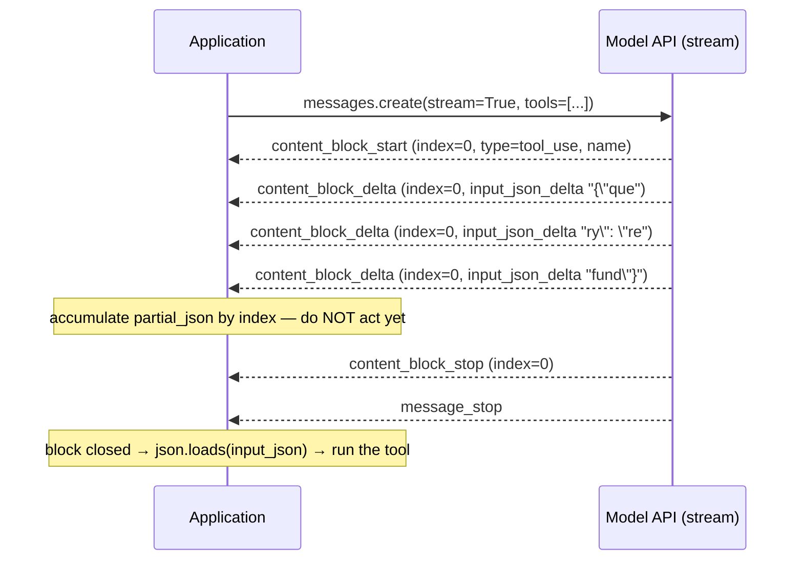
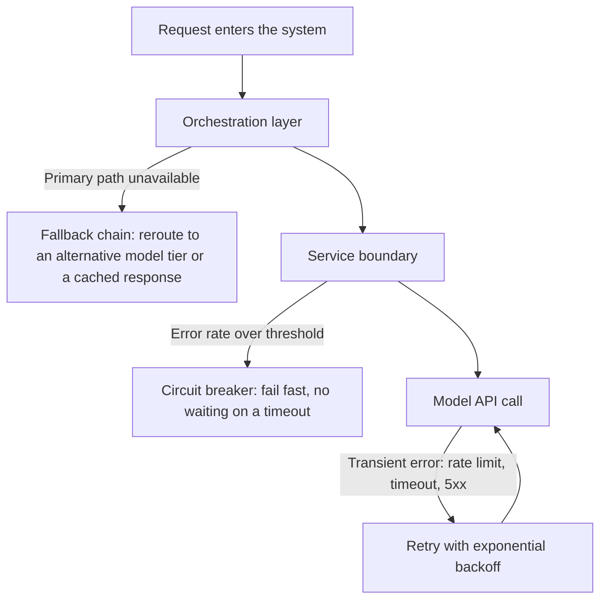
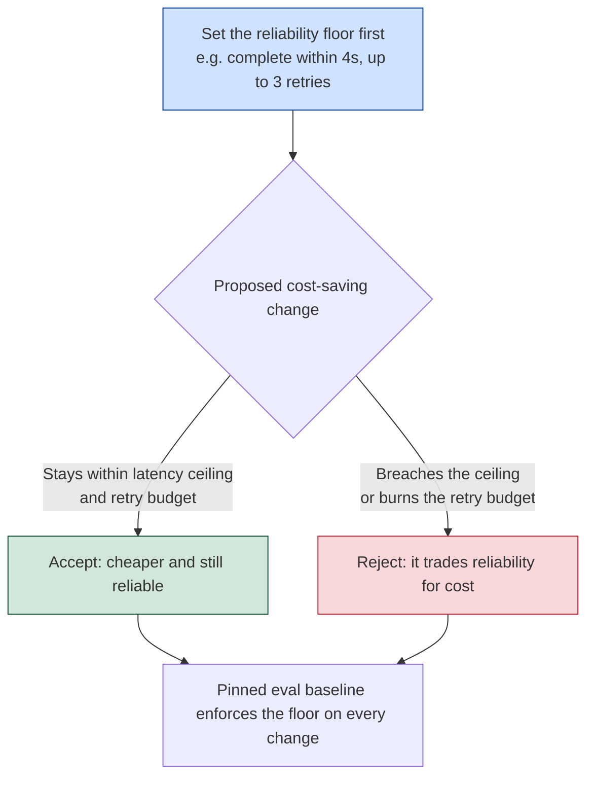

A working prototype answers one question: can the system do this at all? It says almost nothing about whether the system can afford to do it at the volume a real deployment generates, respond fast enough under real load, or keep working when a dependency has a bad day. That gap between a proof of concept (POC) and a production system has four dimensions — cost, latency, reliability, and failure modes — and all four are invisible in a demo.

## Where a POC and a Production System Differ

A POC is built to demonstrate capability. It runs at low volume, on clean inputs, with a patient user watching. A production system runs at whatever volume the business actually generates, on real inputs, for users with no tolerance for a slow or wrong answer.

| Dimension | Why it's invisible in a demo | What it looks like when it fails |
| --- | --- | --- |
| Cost | A POC running a few dozen requests a day produces a negligible bill. Monthly cost at production volume is a different calculation entirely. | The billing dashboard shows a number that exceeds the budget signed off at project approval, and the architecture has to be renegotiated after deployment. |
| Latency | A demo typically runs one request at a time. p95 latency under concurrent load is a different number than median latency on a single request. | SLA breaches and user abandonment — latency that felt fine in a demo is unacceptable in a real-time, user-facing workflow. |
| Reliability | A POC has no retry logic, no fallback, and no circuit breaker. When it fails, the developer just tries again — there are no real users waiting on the other end. | A single transient failure takes the entire user-facing workflow down instead of degrading gracefully. |
| Failure modes | A demo is tested on the inputs the developer expected. Production raises the inputs nobody thought to test, and those failure modes are specific to the chosen architecture. | Silent degradation, fabricated output on an edge-case input, or complete failure on an input class that was never exercised. |

A POC is also the first signal on whether the system moves the business metric it was built to improve, and that signal is worth capturing deliberately, before modeling cost. A cost profile that fits the budget attached to a system that doesn't move the metric that matters is still a failed deployment.

## Cost and Latency Modeling

The cost and latency model gets built *before* the architecture is finalized, from three inputs: call volume (requests per day or month), token budget per request (input tokens plus expected output tokens), and model tier. From those three, a monthly cost estimate can be checked against the budget ceiling before a single line of code is written.

The token budget is where most cost models go wrong. It's tempting to calculate the average token count on the inputs at hand and treat that as the distribution — but real token distributions are usually skewed: most requests are short, and a tail of long requests consumes a disproportionate share of the total cost. A model built on the average alone can underestimate cost by a factor of two or three once that tail shows up at scale.

Latency behaves the same way. Median latency describes the middle of the pack, but SLA breaches come from the slow tail, which is why **p95** (the latency value below which 95% of requests complete) is a more useful design target than the median — it forces the design to account for the requests that are actually going to cause a problem.

**Caching** is the single most effective cost-and-latency lever when a system prompt is long and stable — see [Prompt/Prefix Caching](/ai/agentic-system/caching) for the mechanics. Savings scale with both the length of the cached prefix and how often it's reused, so a long, stable prefix reused across a high volume of requests is where the effective savings are largest. The risk is a consistency window: if the cached content needs to reflect live state, caching can quietly serve something that's gone stale, which is the same live-state boundary covered in [Retrieval vs. Tool Calls](/ai/llm/rag/rag-foundations#retrieval-vs-tool-calls-stable-knowledge-and-live-state).

## The Budget Levers

A cost or latency problem almost always traces to one of a few measurable components, and identifying the lever before tuning it is what keeps optimization from being guesswork. Four levers move the budget:

- **Model selection for the task.** A smaller, faster model cuts both cost and latency; reserve the most capable model for the steps that need it and route simpler work elsewhere. This is the baseline the whole budget sits on — see [Model Selection in Production](/ai/agentic-system/model-selection).
- **Prompt and context size.** Every token in the prompt contributes to cost, so trimming context and removing unnecessary tool output reduces per-call cost directly. This is the [context-engineering](/ai/agentic-system/context-engineering) work applied to operational cost.
- **Number of tool calls.** Each call adds both cost and latency, so a flow that makes more calls than it needs is a common and measurable source of waste — one that becomes visible the moment each call is instrumented.
- **Streamed versus batched output.** Streaming changes how latency is *perceived* by returning the first token as soon as it is ready; batching trades latency for a lower bill on work no user is waiting on (see [Rate Limits and Failure Handling](/ai/agentic-system/rate-limit#concurrency-and-batch-processing)).

### Streaming with Tool Use

Streaming is simple for plain text, but tool use adds a wrinkle worth calling out because getting it wrong fails silently. In a non-streaming call the full response arrives as one object and `tool_use` blocks are directly accessible. In a streaming call the response arrives as a sequence of server-sent events, and a `tool_use` block's input accumulates across several delta events before it is complete. Acting on a partial block produces malformed tool inputs and downstream failures with no error raised.

The pattern the diagram shows is: accumulate `input_json` deltas keyed by block index, and only parse and act once the block closes. The same discipline applies to other LLM streaming APIs — any provider that streams tool/function calls as incremental deltas requires the same accumulate-then-act handling. A stream that breaks mid-response is a transient failure, so the whole request should be retried rather than the partial output passed downstream, which is the [retriable-versus-terminal](/ai/agentic-system/rate-limit#retriable-vs-terminal-failures) distinction applied to streaming.

## Reliability Controls: What Sits Where

Three reliability controls address different failure scenarios, and each belongs at a different layer of the call stack. Placing one in the wrong layer means protecting the wrong part of the system while leaving the right part exposed.

- **Transient error recovery with exponential backoff**, close to the API call itself. When a call returns a transient error — a rate limit, a timeout, a 5xx — the system retries with progressively longer delays between attempts, so a brief hiccup doesn't turn into a flood of retries that prolongs the outage. Set the maximum attempts and total wait time against how much delay the use case can actually tolerate.
- **Circuit breakers**, at the service boundary. A circuit breaker watches the error rate on a downstream dependency and trips once errors cross a threshold; once tripped, requests fail immediately instead of waiting out a timeout, so one degraded dependency doesn't consume the calling system's capacity.
- **Fallback chains**, in the orchestration layer. If the primary model or endpoint is unavailable, the system automatically routes to an alternative — a different model tier, or a cached response — instead of surfacing an error to the user. Fallback behavior belongs in the eval suite, not just in code review, because an untested fallback path is a hope, not a control.

## Setting the Reliability Floor Before Optimizing Cost

The controls above cost something to run, which creates a tension: cost and reliability pull in opposite directions, and cost is the louder of the two. A high bill shows up on a dashboard every day; a reliability problem shows up as occasional failures that are easy to dismiss as noise until they accumulate into an incident. If you optimize cost first, the louder pressure wins and you discover the reliability floor only after crossing it.

The fix is an ordering decision: **set the reliability floor first, then optimize cost beneath it.**

A concrete floor makes the discipline enforceable. Suppose a user-facing request must complete within four seconds and may retry a failed dependency up to three times — those two constraints *are* the floor. Now every cost optimization has to satisfy them. Switching to a smaller, cheaper model is fine *if* it still fits the latency ceiling and does not raise the error rate enough to burn the retry budget. Cutting the retry count from three to two to save money is *not* fine if it pushes the failure rate past what the floor allows, because that trades a lower bill for more failed requests — usually a worse deal in production, where a slightly higher bill is easier to defend than a system that does not work.

This is the same three-way discipline that governs [caching](/ai/agentic-system/caching) and [model selection](/ai/agentic-system/model-selection): you do not chase one dimension in isolation. The eval set is what makes the floor checkable — a pinned baseline score states the minimum acceptable reliability in a form a change either clears or fails, so any cost-saving change that drops the score below the baseline fails the gate before it ships.

## Failure Modes by Architecture Type

Different architectures fail differently, and the mitigation has to match the failure mode, not the architecture's reputation.

| Architecture | What breaks first | Mitigation |
| --- | --- | --- |
| Agent | Unbounded tool use and growing context — an agent with no budget or turn limit runs up cost and latency invisibly until a single request blows through the ceiling. | Per-turn token budgets, a maximum tool-call count, explicit stopping criteria, and a minimal tool set. Eval the agent's stopping behavior, not just its output quality. |
| RAG | Retrieval-quality drift — the index falls out of alignment with the corpus as documents are added or removed without reindexing, or a refresh schedule creates staleness for anything that's actually live state. | Keep retrieval quality in the eval loop; monitor precision and recall as system metrics, not just output quality; keep live-state queries out of the retrieval layer entirely (see [Retrieval vs. Tool Calls](/ai/llm/rag/rag-foundations#retrieval-vs-tool-calls-stable-knowledge-and-live-state)). |
| Document-processing pipeline (evaluator-optimizer) | No exception path for low-confidence extractions — a pipeline that routes every document through the same flow produces wrong outputs on edge cases at the same rate it produces correct ones on clean documents. | Add confidence scoring to extraction; route low-confidence results to a human review queue instead of straight downstream; include edge cases and difficult documents in the eval set. |
| Orchestrator-workers | Failure boundaries blur between the orchestrator and its subagents, traces fragment across the two, and a dropped subagent can fail silently at synthesis. | Define which failures are recoverable at the subagent boundary (retry or flag) versus unrecoverable at the orchestrator; propagate a shared trace ID; reconcile coverage at synthesis so returned results equal dispatched units — see [Agent-to-Agent Communication Architectures](/ai/agentic-system/agent-to-agent) for the retry/fallback mechanics in more depth. |

## Model Version Pinning

Pinning applies to every architecture in the table above equally — it's an operational discipline, not an architecture choice. Pin the model version in configuration, track the provider's deprecation schedule, and maintain a version-update runbook so a forced upgrade is a planned event instead of an incident. For the snapshot-versus-alias mechanics, the Claude 4.6+ ID convention, and keeping a prior pinned configuration as a rollback target, see [Deployment Platform Selection — Pin the Version](/ai/agentic-system/production/deployment-platforms#pin-the-version-so-an-upstream-change-is-not-a-silent-change).

Cost · Complexity · Risk

**Cost:** A POC's cost profile does not predict the production bill. Model cost before committing to an architecture, not after the first billing cycle.

**Complexity:** Retries, fallback chains, and circuit breakers are much harder to retrofit into a system that wasn't designed for them. Build reliability in from the start rather than scrambling after the first incident.

**Risk:** A system with no fallback and no circuit breaker has exactly one point of failure — the primary model endpoint. When it goes down at peak load, there is no recovery path: the whole user-facing workflow fails instead of degrading gracefully.
