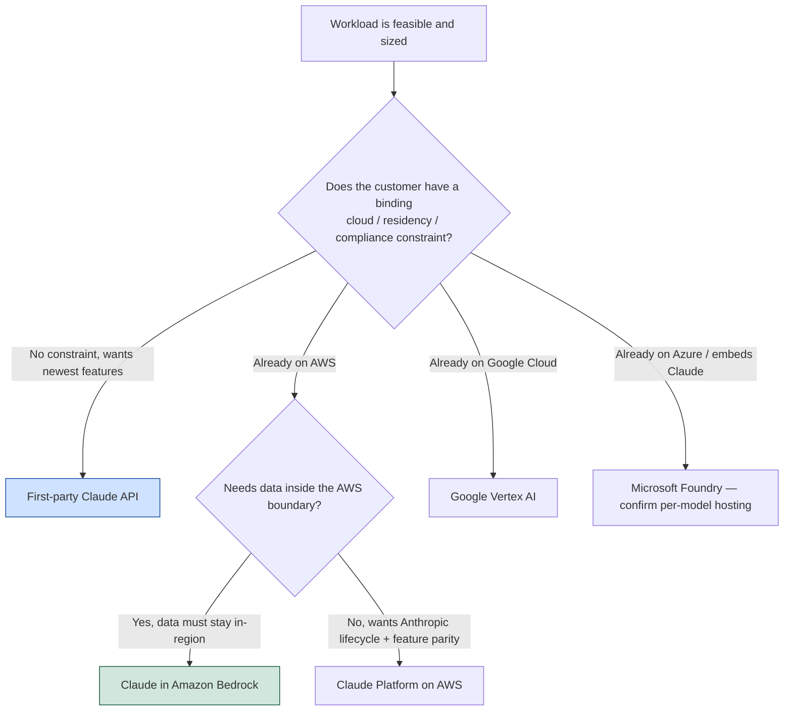

Once a use case is [feasible and sized](/ai/agentic-system/production/feasibility-and-sizing) and its [requirements are written down](/ai/agentic-system/production/feasibility-and-sizing#from-a-business-problem-to-functional-and-infrastructure-requirements), one decision remains before integration: **where does the workload actually run?** In practice this is rarely a greenfield choice. It is usually shaped by where the customer already has cloud infrastructure, identity management, and compliance agreements in place — so the first question is which platform the customer already trusts and operates on, not which platform is technically best in the abstract.

## The Customer's Existing Cloud Usually Decides

The same Claude model is reachable through several platforms, and the model behaves the same way on each. What differs is **which cloud account the spend lands in, which identity system handles authentication, which region the traffic terminates in, and which procurement and compliance contract already covers it**. Those four facts are usually already fixed by the customer's existing footprint, which means the platform decision is often made *for* you by what the customer has already cleared.



The diagram's first branch is the one that matters most: a binding residency or compliance constraint eliminates options *before* any latency or cost comparison begins. Only when the customer has no such constraint does "which platform has the newest features" become the deciding question.

## Where Inference Actually Runs: The Boundary That Matters

A detail that surprises people is that accessing Claude *through* a cloud account does not always mean inference runs *inside* that cloud's boundary. The boundary — where the data is actually processed — is what regulated customers care about, and it varies by platform:

- **First-party Claude API** is Anthropic's own environment and typically receives new features first. There is no cloud-provider boundary involved; identity and terms are Anthropic's.
- **Claude Platform on AWS** is accessed *through* the customer's AWS account using Anthropic's own model IDs and lifecycle, but **inference is Anthropic-operated and runs outside the AWS boundary**. You get Anthropic's model IDs and feature parity with a familiar billing relationship, but the data leaves the AWS boundary for inference.
- **Claude in Amazon Bedrock** runs **inside the customer's configured AWS boundary** — data stays in the Region you configure. This is the path a residency-constrained AWS customer usually needs.
- **Google Vertex AI** uses Google Cloud identity and keeps data inside the Google Cloud boundary, with regional endpoints for residency.
- **Microsoft Foundry** hosts Claude in two forms, and the boundary is **per-model** (see below).

:::warning[Accessing through a cloud account ≠ inference inside that cloud]

Claude Platform on AWS and Claude in Amazon Bedrock both run "on AWS" from a billing perspective, but only Bedrock keeps inference inside the AWS boundary. For a customer whose data must not leave a specific boundary, that distinction is pass-or-fail — confirm it for the exact platform and model before committing.

:::

### Claude in Amazon Bedrock vs Claude Platform on AWS

Because this distinction is easy to miss and matters most to teams that live on AWS, it is worth stating plainly:

| | Claude Platform on AWS | Claude in Amazon Bedrock |
| --- | --- | --- |
| **Where inference runs** | Anthropic-operated, **outside** the AWS boundary | **Inside** the customer's configured AWS boundary / Region |
| **Model IDs & lifecycle** | Anthropic's own model IDs; follows Anthropic's deprecation schedule | Bedrock model IDs with the `anthropic.` prefix; partner retirement dates can differ from Anthropic's |
| **API surface** | First-party-style access | **Messages API** at `/anthropic/v1/messages`, with broad feature parity to the first-party API (a "features-not-supported" list exists — confirm feature-specific needs) |
| **When to choose** | On AWS but wants Anthropic model IDs, lifecycle, and feature parity, with no requirement to keep inference inside AWS | On AWS, needs data inside the AWS boundary, and holds a compliance posture there |

"Broad feature parity" means the Bedrock **Messages API** exposes nearly the same request features as the first-party API (system prompts, tool use, prompt caching, streaming, and so on), minus whatever is on the current not-supported list. That Messages API (`/anthropic/v1/messages`) is the **newer, Anthropic-native** path on Bedrock. The older Bedrock-native path is **`InvokeModel`** (a single, stateless, model-specific call) and **`Converse`** (AWS's unified, model-agnostic, multi-turn/tool-use API) — covered in depth in [Amazon Bedrock — Runtime APIs](/aws/ai/bedrock#runtime-apis-invokemodel-streaming-and-converse). A Bedrock integration still on `InvokeModel`/`Converse` with ARN-versioned identifiers is the legacy path; new work targets the Messages API.

:::note[Native request formats differ by provider]

The "Messages API" is Anthropic-native. Other providers expose their own native formats — OpenAI uses Chat Completions / Responses, and each provider differs — and a hyperscaler like Bedrock additionally wraps models in its own `InvokeModel`/`Converse` interface. So "the native way to call it" is per provider; there is no single cross-provider request shape.

:::

## Identity and Data Residency Are Answered by the Platform

Identity and data location are decided by the platform, not by your application code. Each platform brings its own identity system and boundary:

- **Amazon Bedrock** uses AWS identity (IAM) and keeps data inside the customer's AWS boundary.
- **Google Vertex AI** uses Google Cloud identity (IAM) and boundary.
- **Microsoft Foundry** uses Azure identity (Entra) for the Azure-hosted form.

Both Bedrock and Vertex offer **regional routing** when residency is a constraint, and matching the platform to the customer's existing compliance agreement avoids a data-residency review from scratch. On Bedrock specifically, the choice between **global and regional endpoints** is itself the primary residency control — a global endpoint may route across Regions (often better availability/throughput, and possibly different pricing), while a regional endpoint pins processing to one Region — so confirm both the residency implication and the cost per option.

:::note[Microsoft Foundry residency is per model]

Foundry hosts Claude in two forms: **Hosted on Azure** (inference runs end-to-end on Azure infrastructure, so data stays in the Azure boundary) and **Hosted on Anthropic** (inference runs on Anthropic-operated infrastructure). Which form applies depends on the **specific Claude model** selected, not on a pricing tier — so whether a given deployment satisfies EU-only residency must be confirmed model-by-model with Microsoft at build time.

:::

## The Deployment-Platform Decision Table

| Platform | Identity and data model | When to choose it | How versioning is pinned |
| --- | --- | --- | --- |
| First-party Claude API | Anthropic identity and terms. | No binding cloud or residency constraint; wants the newest capabilities first. | Pin the full model ID and keep the prior snapshot. |
| Claude Platform on AWS | Anthropic identity and terms, accessed through the customer's AWS account; inference Anthropic-operated **outside** the AWS boundary; Anthropic lifecycle. | On AWS but wants Anthropic model IDs, lifecycle, and feature parity. | Pin the same model-ID format as the Claude API (e.g. `claude-opus-4-8`). |
| Claude in Amazon Bedrock | Messages API at `/anthropic/v1/messages`; broad feature parity; data **inside** the customer's AWS boundary. | On AWS, needs data in the AWS boundary, holds a compliance posture there. | Pin the full model ID with the `anthropic.` prefix; partner retirement dates differ from Anthropic's. |
| Claude on Amazon Bedrock (legacy) | AWS identity and billing; `InvokeModel`/`Converse` with ARN-versioned identifiers. | Existing Bedrock integration not yet migrated to the Messages API. | Pin via ARN-versioned model identifiers. |
| Google Vertex AI | Google Cloud identity (IAM) and billing; regional or global endpoints for residency. | On Google Cloud, holds a compliance posture there. | Pin the full model ID using Vertex's format; partner retirement dates differ from Anthropic's. |
| Third-party platform (e.g. Microsoft Foundry) | The wrapping product's identity and billing. Foundry: Azure-hosted (inference on Azure) vs Anthropic-hosted (inference on Anthropic infra), **per model**. | Customer already runs the platform that embeds Claude. | Pin per the platform's versioning controls; confirm residency per model. |

:::note[Product facts drift — verify at build time]

Model IDs, the Foundry model/hosting split, the Bedrock features-not-supported list, and each platform's residency coverage change over time. Confirm them against the relevant provider's documentation (platform.claude.com and the hyperscaler's docs) before committing a regulated workload. The *decision framework* here is stable even when the specific names are not.

:::

## Pin the Version So an Upstream Change Is Not a Silent Change

Versioning is what keeps a model or prompt change from becoming a silent change in production. Every Claude model ID points to a specific model snapshot. Convenience aliases such as "Opus" or "Sonnet" are readable, but they evolve over time and may resolve to different versions across platforms. A **pinned full model ID resolves to a fixed snapshot**, so an upstream model update becomes a deliberate choice rather than something that changes your agent's behavior overnight.

```python
# Moving alias: may resolve to a new version without you knowing
model = "claude-haiku-4-5"

# Pinned snapshot: fixed until you change this line
model = "claude-haiku-4-5-20251001"
```

The discipline has three parts:

1. **Pin the specific snapshot, not the alias.** For Claude 4.6 and later, the model ID alone pins to a snapshot; for earlier models, the ID plus a date suffix is required. Other providers (OpenAI and others) have their own snapshot conventions — the rule is the same regardless: pin the most specific identifier the provider offers. Verify the current convention at platform.claude.com at build time.
2. **Version the prompt and the asset alongside the code**, so a behavior change traces to a specific, reviewable version rather than a mystery.
3. **Keep the prior pinned configuration available as a rollback target.** This is not about the old model disappearing — the provider usually still serves it — it is about retaining *your* known-good configuration (the prior model ID plus the matching prompt and asset versions) so you can redeploy it deliberately if the new version regresses.

The point is stable behavior: an unpinned deployment turns every upstream model update into an untracked change to your output. See [Cost, Latency, and Reliability — Model Version Pinning](/ai/agentic-system/production/cost-latency-reliability#model-version-pinning) for where pinning sits among the other reliability controls.

## Comparing Platforms on Latency, Compliance, and Cost

When more than one platform clears the compliance bar, three dimensions decide between them — and only one of them is usually negotiable.

- **Latency** depends on where the platform runs relative to the customer and how new-feature access is routed. A platform in the customer's own cloud region can cut round-trip time versus a first-party endpoint farther away; the trade-off is that the first-party API typically receives new capabilities first. The number is only meaningful when measured **from the customer's actual region against their actual payload** — a measurement from your laptop hides the round-trip penalty that appears in production.
- **Compliance** often ends the debate before latency or cost is weighed. A customer already certified on one cloud is unlikely to re-certify on another, and **data residency** — the rule that a customer's data must be processed in a specific country or region — is treated as pass-or-fail by regulated finance and healthcare customers, not as a tradeoff to balance. Raise the compliance constraint during scoping (it connects to the [regulated-industry constraints](/ai/agentic-system/safeguarding#regulated-industry-constraints-that-rule-out-options-first) and the [residency/retention/audit controls](/ai/agentic-system/production/enterprise-integration) covered elsewhere), or it surfaces at contract review after the work is done.
- **Cost** varies on more than token price: data egress, platform fees, and integration effort all differ, so compare **total cost per call per platform**, not the headline token rate.

| Dimension | How it differs by platform | How to measure it | Where each platform wins |
| --- | --- | --- | --- |
| Latency | A platform in the customer's region shortens the round trip; the first-party API may reach new features first. | From the customer's actual region against their actual payload. | An in-region cloud platform wins on round-trip latency; the first-party API wins on earliest feature access. |
| Compliance | Residency, certifications, and audit controls are set by the deployment platform. | Against the customer's existing certification and residency requirements, during scoping. | The cloud the customer has already certified wins — no re-certification needed. |
| Cost | Token price, data egress, platform fees, and integration effort all vary. | Total cost per call per platform, including egress and integration — not token price alone. | The platform with the lowest total cost for the actual workload — not always the cheapest token. |

## A Worked Example: Three Defects in a Deployable Asset

Packaging for reuse, deployment versioning, and the multi-component trust boundary tend to fail together, not one at a time. The asset below runs, but it carries one defect from each layer — the same cumulative discipline the [production-hardening design document](/ai/agentic-system/production#the-production-hardening-design-document) exists to enforce:

```python
def build_agent():
    return Agent(
        model="opus",                          # defect 2: moving alias, no rollback target
        repo_path="/Users/priya/project",      # defect 1: hardcoded, not parameterized
        tools=[read_file, run_linter],
    )

fetched = code_task.run(fetch_url=customer_page)   # untrusted content
next_call(input=fetched)                            # defect 3: passed as if trusted
```

- **Packaging:** `repo_path` is hardcoded instead of parameterized, so a new engagement cannot configure it without editing the code — it is not reusable (see [Packaging an Asset for Reuse](/ai/agentic-system/production/team-enablement-and-operational-support#packaging-an-asset-for-reuse)).
- **Deployment / versioning:** `model="opus"` is a moving alias with no retained prior version, so an upstream update silently changes behavior and there is no rollback target. Pin the full snapshot and keep the prior pinned config.
- **Multi-component boundary:** fetched content is passed straight into the next call as if it were trusted instructions, instead of being wrapped so the next component treats it as data (see [Trust Boundaries Across a Multi-Component Application](/ai/agentic-system/safeguarding#trust-boundaries-across-a-multi-component-application)).

Each defect belongs to a different owner, which is why a reusable, deployable asset is reviewed against all three layers before it ships — and why the four decisions of the design document are named up front rather than discovered one incident at a time.
