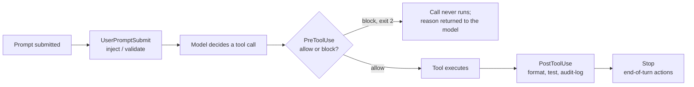

[Claude Code Configuration and Permissions](/ai/agentic-system/claude-code-configuration) covers what a coding agent is *allowed* to do. This page covers the other half: what the agent *knows* and how it behaves, configured so that the rules and context you establish in one session are still in effect at the start of the next. Four mechanisms carry that durable context, and the reason there are four rather than one is that each makes a different trade-off between how much context window it costs and how reliably it applies. Putting every concern into a single file is the most common way to end up with context that is both expensive and easy for the agent to ignore.

:::note[Verify product specifics against current docs]

File locations, frontmatter field names, the set of hook lifecycle events, and which built-in subagents load which context all change over time. Use the distinctions below to decide which mechanism carries which concern, and confirm the current field names and event list against Anthropic's Claude Code documentation before writing configuration.

:::

## The Four Mechanisms at a Glance

Each mechanism answers a different question: what should always be true, what should be true only in one part of the codebase, what must happen deterministically regardless of the model's choices, and what work should run in its own isolated context. Choosing the wrong carrier is what produces a bloated always-on file or a guardrail that only holds some of the time.

<!-- NOTEBOOKLM_DIAGRAM: concept=durable-project-context-four-mechanisms; type=image; goal=show CLAUDE.md, rules files, hooks, and subagents as four carriers of project knowledge, each labelled with what it loads, when it runs, its context cost, and what belongs in it; complexity=intermediate -->

| Mechanism | What it carries | When it applies | Context cost |
| --- | --- | --- | --- |
| CLAUDE.md | Always-on project memory and universal constraints | Loaded at the start of every session | Paid on every session; grows with the file |
| Rules files | Guidance scoped to specific paths | Loaded only when working with matching files | Paid only when the scope matches |
| Hooks | Deterministic enforcement and automated side effects | Fired at fixed lifecycle events, regardless of the model's decision | Runs out-of-band; no model-context cost |
| Subagents | Delegated work in an isolated context | Invoked for a specific task, then returns only its result | Keeps the main session's context clean |

## CLAUDE.md: The File That Loads Into Every Session

Every time Claude Code starts in a project directory, it looks for a file named `CLAUDE.md` at the root and reads it, appending its contents to your prompt before any message of yours arrives. This is what makes it durable: every convention, constraint, and command it holds is present from the first prompt of every session without you restating it. The `/init` command can scan a codebase and generate a starter file, which is a reasonable baseline but should be reviewed and trimmed to the rules that actually change the outcome of your prompts — testing commands, framework conventions, the paths the agent should not touch, and the style decisions that differ from defaults.

Size is the main failure mode, and it is a subtle one because the file keeps working as it degrades. Every instruction added makes the file larger, which consumes more of the context window, which makes any single instruction a smaller fraction of what loads — and that lowers the odds the agent follows the one rule that would have caught a real mistake. The discipline is to hold CLAUDE.md to the constraints that change behavior and move everything else into skills that load on demand. An always-on file earns its place only with content that genuinely needs to be present every time.

## Rules Files: Scoping Guidance to Where It Applies

CLAUDE.md is the right home for guidance that applies across the whole project, but much guidance only matters in one part of the codebase, and loading it everywhere is exactly the dilution problem above. Rules files solve this: they live in the project's `.claude/rules/` directory and can be scoped to specific paths using a `paths` glob in their YAML frontmatter, so a rule enters context only when Claude Code is working with files that match the pattern.

The scoping comes from the frontmatter, not from where the file sits. You can organize rules files into subdirectories such as `.claude/rules/database/`, but that structure is purely organizational — a rules file *without* a `paths` field loads unconditionally at launch, with the same priority as CLAUDE.md, no matter which folder holds it. The practical split is to put broad project memory and universal constraints in CLAUDE.md, and narrow, path-specific guidance in rules files scoped with `paths`. A constraint like "never modify the database schema" belongs in CLAUDE.md because it applies everywhere; a constraint like "all SQL in the database module must declare an explicit transaction boundary" belongs in a scoped rules file:

```markdown
---
paths:
  - "src/db/**/*.sql"
---
All SQL in the database module must include an explicit transaction boundary.
```

Scoped this way, the rule enters context only when Claude is working with those files, and stays out of the way everywhere else.

## Hooks: Deterministic Enforcement at Fixed Points

A hook lets you intercept and act on tool calls before or after they execute, by running your own script at a fixed point in the lifecycle. This is the key distinction from an instruction: when you write "run the formatter after every edit" into CLAUDE.md, the agent will follow it *most* of the time, because it is a probabilistic instruction the model may or may not honor as context shifts. A hook makes the same thing happen *every single time*, because it fires independently of what the model decides. That difference — probabilistic instruction versus deterministic enforcement — is the whole reason hooks exist, and it is why a guardrail that actually must hold belongs in a hook rather than a sentence.

Hooks are defined in settings files and bound to a lifecycle event, an optional matcher that scopes them to specific tool types, and a command that runs when the event fires. The events that cover most guardrail and automation needs are the following.

| Event | When it runs | What it is for |
| --- | --- | --- |
| `PreToolUse` | Before a tool call executes | Examine the call and block it (exit code 2, reason to stderr) — the way to enforce access controls at the configuration layer rather than hoping the agent respects an instruction |
| `PostToolUse` | After a tool call completes | Automated side effects that cannot block the call: formatting after an edit, triggering tests, logging for an audit trail |
| `UserPromptSubmit` | When a prompt is submitted, before the model processes it | Inject context or validate the request before any work starts |
| `Stop` | When the model finishes responding | End-of-turn actions such as notifications, cleanup, or committing an audit log |
| `Notification` | When Claude Code needs permission or has been idle | Route those signals to an external channel or logging system |
| `SessionStart` / `SessionEnd` | When a session starts/resumes or ends | Initialize or validate state at the start; teardown, final audit writes, or notifications at the end |

A `PreToolUse` hook that blocks edits to a production configuration path enforces that constraint at every tool call in every session, regardless of the active permission mode. That is precisely the difference between a guardrail and a convention: the convention asks the model to comply, the guardrail removes the model's ability not to.



The flow shows why `PreToolUse` is the enforcement point and `PostToolUse` is the side-effect point: only the pre-hook runs before the action and can stop it, while the post-hook runs after the action has already happened and is therefore the right place for consequences, not prevention.

## Subagents: Delegating Work to an Isolated Context

A subagent is a specialized assistant that Claude Code delegates a task to, and it runs that task in its own separate context, returning only its output. It does not inherit your main conversation history, the files accumulated in your context, or your current session state — it starts from a clean slate, does the work, and hands back the result. That isolation is the point: it keeps exploratory or investigative work from filling the main session with content that will never be reused.

The isolation has a consequence that trips people up, because built-in subagents differ in what they load at startup, and that difference decides whether your project rules apply. The **Explore** and **Plan** built-in subagents skip CLAUDE.md and git status to keep research fast and cheap, which means project-level rules defined in CLAUDE.md are *not* in their context when they run. The **general-purpose** subagent loads both. So if you delegate a task to Explore or Plan and a CLAUDE.md rule quietly fails to apply, the reason is that the context was never loaded — for any task where your project constraints must be respected, use the general-purpose subagent or a custom subagent that explicitly loads the rules it needs. Custom subagents also do not automatically see your skills: if a custom subagent in `.claude/agents` needs a specific skill, that skill has to be listed in the agent's frontmatter, because built-in agents carry no preloaded skills.

:::warning[Always check which subagent loads your rules]

A rule that "works in the main session" but seems ignored under delegation is usually a loading difference, not a broken rule. Confirm whether the subagent you delegated to loads CLAUDE.md before concluding the rule itself is wrong.

:::

## Giving a Workflow an Explicit Entry Point

A **custom command** is a shortcut to a defined procedure — the agent equivalent of a saved terminal alias or an editor task. In current Claude Code, skills are the recommended format for both explicit and automatic invocation: you invoke a skill directly with `/skill-name`, or Claude loads it automatically when its description matches the work at hand. When you want a workflow that runs *only* when you explicitly call it and never auto-triggers, set `disable-model-invocation: true` in the skill's frontmatter. The older `.claude/commands/` directory format still works but is a legacy path; new workflows should use skills.

Commands shipped inside a plugin are namespaced automatically, with the plugin's name as the prefix: a `run-tests` command in a plugin named `payments` is invoked as `/payments:run-tests`. That namespacing is why two plugins can both ship a `run-tests` command without colliding, and it also means the plugin name is part of the command's interface — renaming the plugin renames every command it ships.

## Choosing the Right Carrier

The four mechanisms are not interchangeable, and the failure mode of forcing them together is concrete: a CLAUDE.md that absorbs path-specific rules dilutes until the agent ignores the important ones, a guardrail written as an instruction holds only probabilistically, and exploration run in the main context crowds out the work it was meant to support. Put universal, always-true constraints in CLAUDE.md; scope path-specific guidance into rules files; make anything that *must* hold deterministic with a hook; and push investigative work into a subagent so it stays out of the main context. The permission layer in [Claude Code Configuration and Permissions](/ai/agentic-system/claude-code-configuration) then sits alongside all four, deciding not what the agent knows but what it is allowed to act on.
