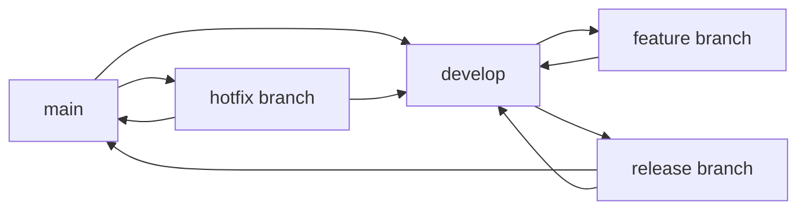
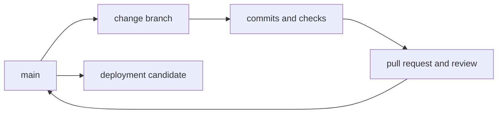
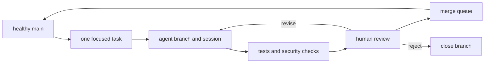
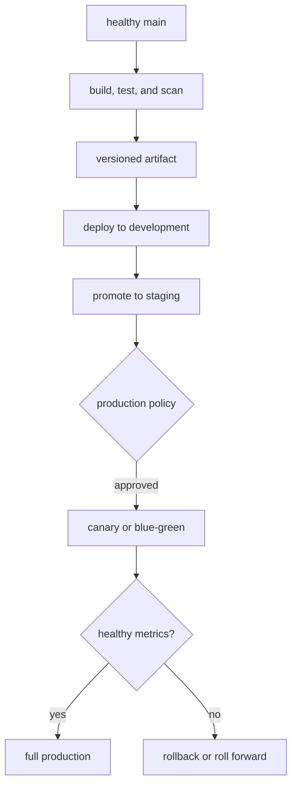

A branching strategy defines where work happens and how quickly it returns to the shared codebase. This is separate from
the [merge mechanism](/software-development/version-control/merge-strategies/) used to integrate it, such as rebase,
squash, or a merge commit.

## The three practical choices

| Strategy | Best fit today | Branch and release model |
| --- | --- | --- |
| **Gitflow** | Versioned products, scheduled releases, and multiple supported versions | Features merge into `develop`; release and hotfix branches control promotion to `main` |
| **GitHub Flow** | Most cloud applications, APIs, documentation, and small-to-medium teams | Each change uses a branch and pull request into a release-ready `main` |
| **Trunk-based development** | High-throughput teams with fast CI, including teams delegating small tasks to coding agents | Work reaches `main` at least daily, directly or through branches that last only hours |

These models are not maturity levels. The right choice depends on release topology, review requirements, and how reliably
the team can keep `main` healthy.

## Gitflow

Gitflow keeps two long-lived branches: `develop` for integrated work toward the next release and `main` for released
versions. Feature branches start from `develop`; release branches stabilize a planned version; hotfix branches repair a
released version without waiting for unfinished work in `develop`.

The workflow separates ongoing development from release stabilization and urgent production repairs.

Feature work returns to `develop`, while release and hotfix branches must merge into both `main` and `develop` so fixes
are not lost from the next version.

This structure remains useful when software is explicitly versioned or when several versions must be supported in the
wild. It also makes scheduled release preparation and production hotfixes visible in the repository.

:::warning Gitflow is not the default for continuously delivered web applications

Gitflow's author now recommends a simpler workflow such as GitHub Flow for continuously delivered software. Keep
Gitflow when release branches solve a real version-support problem, not only because the branch names are familiar.

:::

### Deployment across dev, staging, and production

Gitflow ties each environment to a branch rather than to a single promoted artifact:

- `develop` builds deploy to a shared development or integration environment where in-progress features are validated together.
- A `release` branch deploys to staging, where the planned version is stabilized and QA-tested; only fixes land here while new features keep flowing into `develop`.
- Merging the release into `main` and tagging it produces the production build, so the tagged commit on `main` is exactly what ships to production.
- A `hotfix` branch builds a patched artifact from `main`, is verified in staging, deploys to production, and merges back into both `main` and `develop` so the fix survives in the next version.

Because branches define environments, Gitflow gives scheduled releases and multiple supported versions a clear audit
trail, but it adds latency between merging a feature and reaching production.

## GitHub Flow

GitHub Flow uses one long-lived default branch. Each unrelated change gets a descriptive branch, commits, automated
checks, and a pull request. After review, the branch merges into `main` and is deleted. GitHub's current documentation
describes this as a lightweight branch-based workflow and recommends separate branches for unrelated changes.

Each change follows the same short path from an isolated branch back to the default branch.

The pull request is the review boundary, but merging and production deployment can remain separate decisions.

This is the most practical default when every merge to `main` should be releasable but production deployment may still
have an approval gate. It gives reviewers a clear change unit without introducing permanent development, release, or
environment branches.

Use GitHub Flow when pull requests are the normal collaboration boundary and a change may need several review rounds.
Keep branches small and short-lived; otherwise the workflow retains GitHub Flow's name but accumulates the integration
costs of long-lived feature branches.

### Deployment across dev, staging, and production

GitHub Flow deploys from one default branch and promotes a single `main` artifact:

- Each pull request can start a short-lived preview or development environment so reviewers see the change running before it merges.
- Merging to `main` builds a release-ready artifact that typically deploys automatically to staging for integration and acceptance checks.
- Production promotes that same artifact, either automatically for continuous deployment or behind an approval gate; some teams deploy a branch to production first and merge only after it proves healthy.
- Because `main` must stay deployable, a bad release is fixed forward with a new pull request rather than a long-lived fix branch.

This keeps a short, auditable path from change to production and fits continuously delivered web applications and APIs.

## Trunk-based development and agent pull requests

Trunk-based development keeps work close to `main`. Google DORA defines the practice by small batches, no more than a
few active branches, and merging to trunk at least once a day. A small team may commit directly to `main`; a larger team
can use pull requests as long as their branches normally last hours rather than days or weeks.

**An agent pull request is not a separate formal branching strategy.** Current GitHub Copilot documentation says its
coding agent works on one branch at a time and can open one pull request per task. That is a task-isolation mechanism. It
resembles GitHub Flow by itself and qualifies as trunk-based development only when the task is small and the branch is
merged back quickly.

Agent-assisted trunk-based work adds task isolation without allowing agent branches to become long-lived development
lines.

Automated checks and human review protect `main`; the branch is merged or closed promptly instead of becoming another
permanent integration branch.

For agent-assisted work, a defensible trunk-based policy is:

- assign one focused task to one isolated branch and pull request;
- require the same build, tests, security checks, and branch protection used for human-authored changes;
- keep human review accountable for correctness, architecture, and production risk;
- limit concurrent agent branches that touch the same code;
- update from `main`, resolve conflicts, and merge or close the pull request promptly;
- delete the branch after merge and use feature flags for incomplete user-facing behavior.

The useful adaptation for agent-assisted work is smaller pull requests and faster validation, not more long-lived
branches or weaker review.

### Deployment across dev, staging, and production

Trunk-based development standardizes integration, not deployment. Every merge to `main` builds one immutable, versioned
artifact that is then promoted through environments; the environments are promotion stages, not branches.

The same artifact moves forward while configuration, credentials, approval state, and traffic exposure change at each
boundary:

- **Development**: CI deploys the new artifact automatically and runs smoke, integration, and contract tests for fast feedback; a failed deploy blocks promotion and is fixed with a new commit to `main`. Pull requests may get disposable preview environments, but production candidates are rebuilt from the accepted trunk commit.
- **Staging**: the exact artifact that passed development is promoted without rebuilding into a production-like environment that validates deployment automation, database migrations, infrastructure, security policy, and acceptance tests against synthetic or sanitized data. Routine changes promote automatically; higher-risk changes such as schema, identity, infrastructure, or sensitive data require approval.
- **Production**: the approved artifact and its configuration roll out progressively through a canary or blue-green deployment, expanding only while metrics, logs, and traces stay healthy. Feature flags expose new behavior separately from deploying code, and a rehearsed recovery path rolls back to the previous artifact or rolls forward when stateful changes make reversal unsafe.

Branch protection and merge queues keep `main` healthy, while deployment automation, observability, feature flags,
progressive rollout, and a tested recovery path protect production. Large teams then choose between two release paths on
top of this flow:

| Release path | When it fits | Production behavior |
| --- | --- | --- |
| **Release from trunk** | Services with strong automation and frequent releases | Tag or identify a tested commit, promote its artifact, and fix failures through the normal trunk path |
| **Just-in-time release branch** | Scheduled releases, packaged software, or maintained versions | Cut a short release branch from a known-good trunk commit; develop fixes on trunk first and selectively backport them |

A just-in-time release branch stays trunk-based because feature development continues on trunk; the branch is a
temporary stabilization line, not a second permanent development branch like Gitflow's `develop`.

:::info Continuous delivery is not continuous deployment

Continuous delivery keeps every accepted change deployable and lets the organization decide when to release. Continuous
deployment automatically releases every accepted change. A large or regulated team can use trunk-based development and
continuous delivery while retaining production approval gates.

:::

## Choosing a default

Keep **Gitflow** when you ship explicit versions or maintain multiple supported releases. Choose **GitHub Flow** for the
general cloud-application default. Adopt **trunk-based development**, including short-lived agent pull requests, when CI,
branch protection, review speed, observability, and rollback are strong enough to keep `main` continuously healthy.

Branching and deployment remain separate decisions. A merge can deploy automatically to a preview or test environment
while production still requires approval for database migrations, infrastructure, identity, sensitive data, or other
high-risk changes.

## Further reading

- [A successful Git branching model](https://nvie.com/posts/a-successful-git-branching-model/) includes Gitflow's original model and its author's current caveat.
- [GitHub Flow](https://docs.github.com/en/get-started/using-github/github-flow) documents the branch, pull request, review, merge, and deletion workflow.
- [DORA: Trunk-based development](https://dora.dev/capabilities/trunk-based-development/) defines the branch-lifetime and integration-frequency criteria.
- [DORA: Continuous delivery](https://dora.dev/capabilities/continuous-delivery/) describes the automation, security, architecture, and observability needed beyond trunk-based integration.
- [Branch for release](https://trunkbaseddevelopment.com/branch-for-release/) explains just-in-time release branches and trunk-first fixes.
- [GitHub Copilot coding agent](https://docs.github.com/en/copilot/concepts/agents/coding-agent/about-coding-agent) documents its current branch, pull request, testing, and review boundaries.